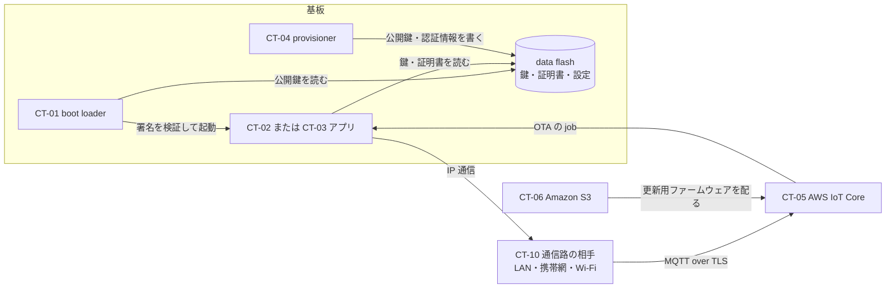
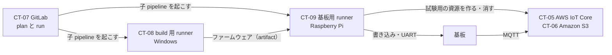
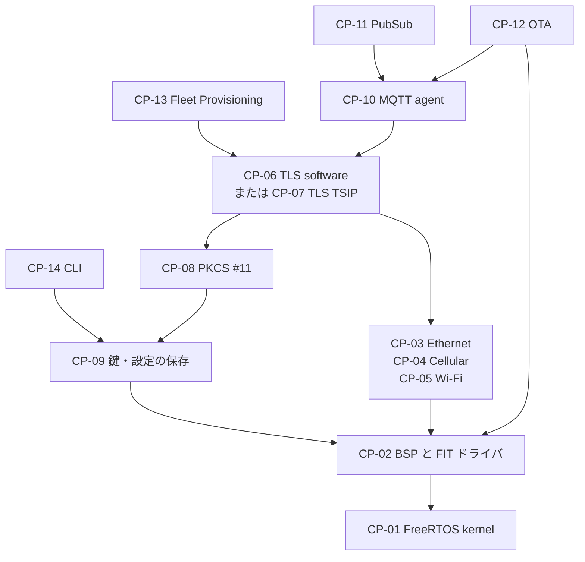
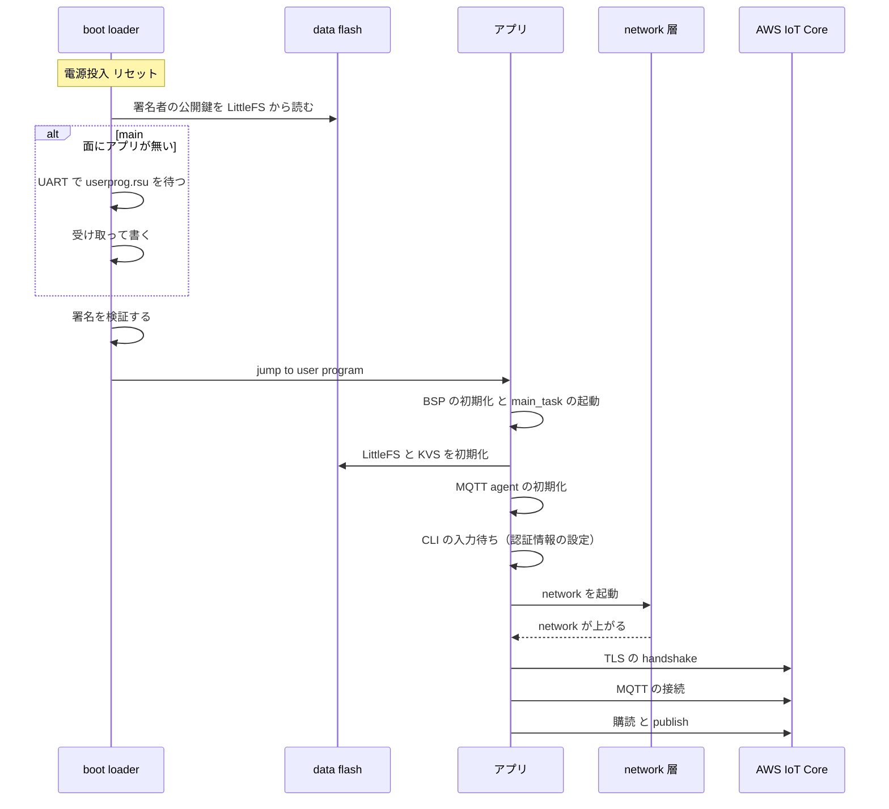

# 機能仕様書（アーキテクチャ）

[[_TOC_]]

この文書は、この repo の機能仕様書です。何を満たすか（要求）、何で構成するか（コンテナとコンポーネント）、どの順に起動するか、資源をどう分けるか、コードがどこにあるかを示します。要求の 1 つずつが、どの構成要素で満たされるかを表にして、漏れを確かめます。

実装の細かい設計、試験の基準、運用の手順は、次の文書にあります。

| 文書 | 内容 |
|---|---|
| [README.md](../README.md) | repo の入口。対応ターゲット、代表性能、検証状態 |
| [docs/details/mqtt.md](details/mqtt.md)、[ota.md](details/ota.md)、[fleet-provisioning.md](details/fleet-provisioning.md) | 機能ごとの実装仕様書（2 節） |
| [docs/test-specification.md](test-specification.md) | 36 試験のテスト番号、期待値、合否の基準 |
| [docs/details/ci-pipeline.md](details/ci-pipeline.md) | CI の流れ、pipeline を起こす変数、基板ごとの試験の流れ |
| [docs/details/cellular/rx65n-cellular.md](details/cellular/rx65n-cellular.md) | RX65N の Cellular 通信の実装 |
| [Changelog.md](../Changelog.md) | リリースごとの変更 |

## 1. 要求の一覧

要求は、[README.md](../README.md)、[Changelog.md](../Changelog.md)、[docs/test-specification.md](test-specification.md)、[tools/ci/tests.json](../tools/ci/tests.json) に書かれている事から拾いました。新しく作った要求はありません。

分類は、大分類が `FUNC`（機能要件）と `NFUNC`（非機能要件）、中分類が次の 6 つです。

| 大分類 | 中分類 | 対象 |
|---|---|---|
| `FUNC` | `OP` | 利用者または外部の機器の操作と、その結果 |
| `FUNC` | `DISP` | 表示・通知として観測する値 |
| `FUNC` | `LIMIT` | 禁止条件、安全側の制約 |
| `NFUNC` | `INTERNAL` | 内部処理、責務の境界、通信の手順 |
| `NFUNC` | `DIAG` | ログ、観測のしやすさ、保守 |
| `NFUNC` | `PERF` | 速度、資源の余裕、信頼性 |

| 番号 | 要求 | 大分類 | 中分類 | 出典 |
|---|---|---|---|---|
| `REQ-01` | RX72N Envision Kit を、Ethernet で AWS IoT Core につなぐ | `FUNC` | `OP` | README「対応ターゲット」 |
| `REQ-02` | CK-RX65N V1 を、BG96 の Cellular で AWS IoT Core につなぐ | `FUNC` | `OP` | README「対応ターゲット」 |
| `REQ-03` | EK-RX671 を、Murata Type 1YN の Wi-Fi で AWS IoT Core につなぐ | `FUNC` | `OP` | README「対応ターゲット」 |
| `REQ-04` | 3 基板が、MQTT で AWS IoT Core へ接続し、topic を購読し、publish する | `FUNC` | `OP` | test-specification「MQTT」（M1〜M4）、tests.json の `feature` |
| `REQ-05` | 3 基板が、AWS IoT の OTA で新しい版のファームウェアを受け取り、その版で起動する | `FUNC` | `OP` | test-specification「OTA」（O1〜O3）、README「OTA」 |
| `REQ-06` | 3 基板が、Fleet Provisioning で証明書と thing の名前を受け取り、その証明書で再接続する | `FUNC` | `OP` | test-specification「Fleet Provisioning」（F1〜F3） |
| `REQ-07` | TLS を software（Mbed TLS）で行う構成を持つ | `NFUNC` | `INTERNAL` | README 冒頭、tests.json の `backend` |
| `REQ-08` | TLS を TSIP（MCU 内蔵の暗号）で行う構成を持つ | `NFUNC` | `INTERNAL` | README 冒頭、Changelog「v…-saffti-1.1.0」 |
| `REQ-09` | TLS 1.2 と TLS 1.3 の両方で接続でき、要求した版で handshake する | `NFUNC` | `INTERNAL` | test-specification「TLS の版の見方」、tests.json の `tls` |
| `REQ-10` | boot loader が、署名者の公開鍵で ECDSA の署名を検証し、合わないファームウェアを起動しない | `FUNC` | `LIMIT` | test-specification「O3」、「OTA の判定（共通）」 |
| `REQ-11` | 2 面（dual bank）に更新用のファームウェアを書き、再起動で切り替える | `NFUNC` | `INTERNAL` | Changelog「v…-saffti-1.0.0」、test-specification「O1〜O3」 |
| `REQ-12` | 証明書・鍵・接続先などの認証情報を、基板に設定できる（UART の CLI、provisioner、build への組み込み、Fleet Provisioning） | `FUNC` | `OP` | test-specification「基板で形が違う所」 |
| `REQ-13` | 認証情報を、repo・文書・ログに書かない | `FUNC` | `LIMIT` | README「最短の開始方法」、test-specification「試験の前提」 |
| `REQ-14` | TSIP の構成では、秘密鍵を平文のまま基板へ渡さない（TSIP 用に包んだ鍵を使う） | `FUNC` | `LIMIT` | test-specification「M1」 |
| `REQ-15` | RX65N の Cellular は、`r_cellular` の BG96 対応 fork を使い、FreeRTOS Cellular Interface へ移行しない | `NFUNC` | `INTERNAL` | README「対応ターゲット」 |
| `REQ-16` | ベースを FreeRTOS 202604.00-LTS-rx にする | `NFUNC` | `INTERNAL` | README 冒頭、Changelog「v…-saffti-1.0.0」 |
| `REQ-17` | TLS 1.3 の session resumption と 0-RTT を確かめられる（旧構成の LANBENCH 対向。共通化後の TSIP の 0-RTT は未対応。CI の対象外） | `NFUNC` | `INTERNAL` | README「現在の検証状態」、Changelog「v…-saffti-1.3.0」、test-specification「非対象」 |
| `REQ-18` | 通信の速度（TCP・software TLS・TSIP TLS の送信と受信）を測れる | `NFUNC` | `PERF` | README「代表性能」 |
| `REQ-19` | OTA の時間（ダウンロード、更新確定まで）を測れる | `NFUNC` | `PERF` | README「OTA」 |
| `REQ-20` | RX671 の OTA で、更新後の heap・network buffer・Wi-Fi の buffer の余裕を見る | `NFUNC` | `PERF` | test-specification「O3」、「基板で形が違う所」 |
| `REQ-21` | 基板の UART のログの行だけで、試験の合否を決められる | `NFUNC` | `DIAG` | test-specification「位置づけ」、「合否の基準」 |
| `REQ-22` | 基板 3 種 × TLS の実装 2 種 × TLS の版 2 種 × 機能 3 種の 36 試験を、実機の CI で自動で流せる | `NFUNC` | `DIAG` | test-specification「位置づけ」、tests.json の `ready` |
| `REQ-23` | 同じ基板の試験は同時に 1 本だけ動き、試験が AWS に作った資源は終わりに消える | `NFUNC` | `INTERNAL` | test-specification「試験の前提」 |
| `REQ-24` | IoT Device Tester（IDT）を 3 ターゲットで実行できる（CI の対象外。全 IDT は未合格） | `NFUNC` | `DIAG` | README「IoT Device Tester（IDT）」、test-specification「非対象」 |
| `REQ-25` | TSIP の network transport が、接続ごとに Maximum Fragment Length 拡張を無効にできる | `NFUNC` | `INTERNAL` | Changelog「v…-saffti-1.4.0」 |
| `REQ-26` | RX671 で、Tracealyzer と J-Link RTT による CPU 負荷の測定ができる | `NFUNC` | `DIAG` | Changelog「v…-saffti-1.4.0」 |

要求は 26 件です。`FUNC` が 10 件、`NFUNC` が 16 件です。

## 2. 機能と実装仕様書

### 2.1 機能の一覧

この repo のファームウェアの機能を、AWS IoT Core から見える働きの単位で 3 つに分けます。機能ごとに実装仕様書を 1 つ `docs/details/` に置き、仕様書キーを 1 つ割り当てます。

| 仕様書キー | 機能 | 働き | 実装仕様書 | 満たす要求 |
|---|---|---|---|---|
| `MQTT` | AWS IoT Core への接続 | 通信路を上げ、TLS で AWS IoT Core につなぎ、MQTT で接続し、topic を購読し、publish する | [details/mqtt.md](details/mqtt.md) | `REQ-01`〜`REQ-04`、`REQ-07`〜`REQ-09`、`REQ-12`、`REQ-14` |
| `OTA` | OTA による更新 | AWS IoT Jobs で更新の指示を受け、MQTT で新しい版を受け取り、署名を確かめ、面を切り替えて新しい版で起動する | [details/ota.md](details/ota.md) | `REQ-05`、`REQ-10`、`REQ-11`、`REQ-20` |
| `FLEET` | Fleet Provisioning | claim 証明書で接続し、CSR で新しい証明書と thing の名前を受け取り、その証明書で接続し直す | [details/fleet-provisioning.md](details/fleet-provisioning.md) | `REQ-06`、`REQ-13`（UART に機密の payload を出さない部分） |

どの機能も、次の 2 つの軸のすべての組み合わせで持ちます。

- 基板 3 種: RX72N Envision Kit（Ethernet）、CK-RX65N V1（BG96 の Cellular）、EK-RX671（Type 1YN の Wi-Fi）
- TLS の実装 2 種（software の Mbed TLS、TSIP）× TLS の版 2 種（1.2、1.3）

機能 1 つ × 軸の組み合わせ 12 通りが、試験の 1 項目です。機能 3 つで 36 項目です。

### 2.2 機能に共通の決まり

次の決まりは、3 つの機能のすべてに掛かります。独立した仕様書キーを持たず、各機能の試験の全項目で確かめます。同じ観測を 2 つの番号で数えないためです。

| 決まり | 内容 | 実装の置き場 | 確かめ方 |
|---|---|---|---|
| TLS の版 | 要求した版（1.2 か 1.3）で handshake し、ほかの版でつながない（`REQ-09`）。接続ごとに `TLS handshake successful: version <版>` を UART に出す。RX671 の software の MQTT の smoke のアプリは、`AWS TLS version=<版>` も出す | `CP-06`・`CP-07` の `transport_mbedtls_pkcs11*.c` | 各試験の期待値に「出た版の行がすべて要求した版」を含める |
| 認証情報の設定 | 証明書・鍵・接続先を基板に入れる（`REQ-12`）。入れ方は基板と機能で違い、各実装仕様書に書く | `CP-09`・`CP-14`・`CP-15`、`CT-04` | 各試験の前提の step。失敗すると、その試験は不合格 |
| UART のログ | 機能の節目を、決まった文字列の行で UART に出す（`REQ-21`）。行の文字列は、各実装仕様書の「UART に出す行」の表を正とする | `CP-16` と各機能の source | 試験の合否は、この行で決める |

### 2.3 テスト番号の体系

- コンポーネントコードは `IREF`（この repo）です。テスト番号は `IREF-<仕様書キー>-<連番 3 桁>` です。
- 連番は、仕様書キーの中で、基板（RX72N → RX65N → RX671）、TLS の実装（software → TSIP）、TLS の版（1.2 → 1.3）の順に 001 から振ります。
- 番号は [`tools/ci/tests.json`](../tools/ci/tests.json) の `ids` に書いて固定します。軸の並びを変えても番号は変わりません。正式にした番号は変えず、使い回しません。
- 番号ごとの期待値と状態は、[試験仕様](test-specification.md)の一覧表にあります。

- `IREF` iot-reference-rx: [docs/test-specification.md](test-specification.md)
  - `IREF-MQTT-001`〜`012`: [docs/details/mqtt.md](details/mqtt.md)
  - `IREF-OTA-001`〜`012`: [docs/details/ota.md](details/ota.md)
  - `IREF-FLEET-001`〜`012`: [docs/details/fleet-provisioning.md](details/fleet-provisioning.md)

### 2.4 試験の番号を持たない要求

次の要求は、3 つの機能のどれにも属さず、実機の CI の試験を持ちません。理由を付けて残します。

| 要求 | 試験を持たない理由 |
|---|---|
| `REQ-13`（repo・文書・ログに認証情報を書かない） | 運用の決まり。CI の側で、認証情報を CI 変数から渡し、image を暗号化して受け渡す（[CI/CD 運用](details/ci-pipeline.md)）。UART の部分だけ `FLEET` で確かめる |
| `REQ-15`（`r_cellular` の BG96 対応 fork を使う）、`REQ-16`（ベースの版） | 構成の決まり。submodule の参照で決まり、`MQTT`・`OTA`・`FLEET` の RX65N の試験が、その構成で動く事を確かめる |
| `REQ-17`（TLS 1.3 の再開と 0-RTT） | CI の対象外（[試験仕様](test-specification.md#非対象)） |
| `REQ-18`（通信の速度）、`REQ-19`（OTA の時間） | 測定であり、合否の試験ではない。測った値は [README](../README.md) と [OTA 性能](details/validation/ota-performance.md) |
| `REQ-22`（36 試験を CI で流せる）、`REQ-23`（基板の排他と AWS の資源の片付け） | CI 自身の決まり。CI の道具の単体試験（`tools/ci/test_rxci*.py`）で確かめる |
| `REQ-24`（IDT） | CI の対象外（[IDT 検証](details/idt/idt-validation.md)） |
| `REQ-25`（Maximum Fragment Length の無効化）、`REQ-26`（Tracealyzer と RTT） | 個別の機能で、CI の試験が無い |

## 3. コンテナ（C4 の 2 段目）

別々に動く物、または別々に置かれる物を、コンテナと呼びます。基板の上のコンテナ、AWS 側のコンテナ、CI のコンテナがあります。

| 番号 | コンテナ | 置かれる場所 | 役割 |
|---|---|---|---|
| `CT-01` | boot loader | 基板の code flash の末尾 64 KiB | 電源投入で最初に動く。署名を検証して、アプリへ制御を渡す。UART でファームウェアを受け取って書く |
| `CT-02` | アプリ（software 版） | 基板の code flash の main 面 | FreeRTOS の上で、network・TLS（Mbed TLS）・MQTT・OTA・Fleet Provisioning・CLI を動かす |
| `CT-03` | アプリ（TSIP 版） | 同上 | `CT-02` と同じ機能。TLS の暗号を TSIP が行う |
| `CT-04` | provisioner | 基板の code flash の main 面（保守用） | 署名者の公開鍵と認証情報を、CLI で data flash に書く。network も MQTT も動かさない |
| `CT-05` | AWS IoT Core | AWS | MQTT の相手。Jobs（OTA の指示）と Fleet Provisioning を受け持つ |
| `CT-06` | Amazon S3 | AWS | OTA の更新用ファームウェアの置き場 |
| `CT-07` | GitLab と pipeline | GitLab | 試験の選択、子 pipeline の作成と起動 |
| `CT-08` | build 用 runner | Windows の機体 | e² studio の command line と CC-RX でファームウェアを作る |
| `CT-09` | 基板用 runner | 基板につないだ Raspberry Pi | 書き込み器（`rfp-cli`）と UART で、基板に書き込み、観測する |
| `CT-10` | 通信路の相手 | 基板の外 | Ethernet の LAN、携帯網（BG96 経由）、Wi-Fi のアクセスポイント |

基板ごとの違いです。

| 項目 | RX72N Envision Kit | CK-RX65N V1 | EK-RX671 |
|---|---|---|---|
| boot loader の project | `boot_loader_rx72n_envision_kit` | `boot_loader_ck_rx65n` | `boot_loader_rx671_ek` |
| アプリ（software 版） | `aws_ether_rx72n_envision_kit` | `aws_bg96_ck_rx65n` | `aws_wifi_rx671_ek` |
| アプリ（TSIP 版） | `aws_ether_rx72n_envision_kit_tsip` | `aws_bg96_ck_rx65n_tsip` | `aws_wifi_rx671_ek_tsip` |
| provisioner | CI が `tools/build_public_signer_provisioner.py` で、アプリの source から作る | 同左 | 同左（OTA の束にも入る） |
| 通信路 | Ethernet | BG96 の Cellular | Type 1YN の Wi-Fi |

アプリと provisioner は、同じ領域に別々に書かれ、同時には動きません。アプリは `CT-02` と `CT-03` のどちらか 1 つです。

CI は、基板の外で動きます。

- build 用 runner と基板用 runner は、別の機体です。ファームウェアは artifact として渡します。
- AWS への入り口は、GitLab が job ごとに発行する ID token です。使う role は group 変数が決めます。詳しくは [CI/CD 運用](details/ci-pipeline.md)にあります。

## 4. コンポーネント（C4 の 3 段目）

コンテナの中の機能のまとまりを、コンポーネントと呼びます。現物のソースにあるものだけを書きます。

### 4.1 アプリのコンポーネント

| 番号 | コンポーネント | 主な場所 | 役割 |
|---|---|---|---|
| `CP-01` | FreeRTOS kernel | `Middleware/FreeRTOS/FreeRTOS-Kernel`、各 project の `src/frtos_config/FreeRTOSConfig.h` | task・queue・heap。RX72N と RX671 は `RX700v3_DPFPU`、RX65N は `RX600v2` の port |
| `CP-02` | BSP と FIT ドライバ | `Middleware/Renesas/rx-driver-package`、`r_flash_rx`、`rm_rtos_abstraction_rx`、各 project の `src/smc_gen/` | 起動、SCI の UART、flash の書き込み（`r_flash_rx`）。コードは Smart Configurator が出す |
| `CP-03` | network 層（Ethernet） | `Common/FreeRTOS_common/network_support/onchip_rx_ether`、`Middleware/FreeRTOS/FreeRTOS-Plus-TCP`、`r_ether_rx`、`sockets_wrapper/ports/freertos_plus_tcp` | RX72N の TCP/IP |
| `CP-04` | network 層（Cellular） | `Middleware/Renesas/r_cellular`、`Common/ports/r_cellular`、`sockets_wrapper/ports/cellular_ryz014a`、`aws_bg96_ck_rx65n/.../bg96_probe.c` | RX65N の BG96 の接続と socket |
| `CP-05` | network 層（Wi-Fi） | `Projects/aws_wifi_rx671_ek/external/wifi-host-driver`、`src/whd_port/`、`src/sdio_host.c`、`src/whd_bringup.c`、`r_sdio_rx`、`r_sdhi_rx`、`Middleware/FreeRTOS/FreeRTOS-Plus-TCP` | RX671 の Type 1YN。SDIO で WHD を動かし、FreeRTOS+TCP につなぐ |
| `CP-06` | TLS 層（software） | `Middleware/network_transport/using_mbedtls_pkcs11`、`Middleware/3rdparty/mbedtls` | Mbed TLS で TLS を行う。鍵は PKCS #11 から使う |
| `CP-07` | TLS 層（TSIP） | `Middleware/network_transport/using_mbedtls_pkcs11_with_tsip`、`Middleware/3rdparty/mbedtls_with_TSIP`、`r_tsip_rx`、`Common/common_api/r_common_api_tsip.c` | TSIP の暗号で TLS を行う。`_tsip` の project だけ |
| `CP-08` | PKCS #11 | `Middleware/FreeRTOS/corePKCS11`、`Common/ports/rm_aws_pkcs11_pal_littlefs`、`Demos/common/pkcs11_helpers` | 鍵・証明書の object の窓口。保存先は `CP-09` |
| `CP-09` | 鍵・設定の保存 | `Middleware/3rdparty/littlefs`、`Middleware/Renesas/rm_littlefs_rx`、`Common/littlefs_common`、`Demos/cli/store.c` | data flash の上の LittleFS と、key-value の保存（KVS） |
| `CP-10` | MQTT agent | `Middleware/FreeRTOS/coreMQTT`、`coreMQTT-Agent`、`Demos/mqtt_agent`、`Demos/common/mqtt-agent-interface`、`Demos/common/mqtt-wrapper` | MQTT の接続と、複数の task からの publish・購読の仲介 |
| `CP-11` | PubSub | `Demos/SimplePubSub` | topic の購読と publish |
| `CP-12` | OTA | `Demos/OtaOverMqtt`、`Common/ports/ota_pal`、`Middleware/AWS/Jobs-for-AWS-IoT-embedded-sdk`、`Middleware/AWS/aws-iot-core-mqtt-file-streams-embedded-c`、`Middleware/FreeRTOS/coreJSON`、各 project の `src/frtos_config/rx_ota_config.h` | AWS IoT Jobs で更新を受け、MQTT でファームウェアを受け取り、反対側の面に書いて署名を確かめ、面を切り替える |
| `CP-13` | Fleet Provisioning | `Demos/Fleet_Provisioning_With_CSR_Demo`、`Middleware/AWS/Fleet-Provisioning-for-AWS-IoT-embedded-sdk`、`Middleware/3rdparty/tinycbor` | claim 証明書で接続し、CSR で証明書と thing の名前を受け取る |
| `CP-14` | CLI | `Demos/cli`、`Middleware/FreeRTOS-Plus-CLI` | UART のコマンド。認証情報の設定（`conf set`・`commit`）。アプリの起動後 10 秒の入力待ちがある（RX72N） |
| `CP-15` | TSIP の鍵の設定 | `Demos/tsip_provisioning`、`Demos/key_flash_wr_with_tsip` | UART の `tsipprov` で、包んだ鍵を data flash に書く。`_tsip` の project だけ |
| `CP-16` | ログと Tracealyzer | `Middleware/logging`、`Common/ports/trace_recorder`、`Middleware/3rdparty/TraceRecorderSource` | UART のログ、実行の記録 |
| `CP-17` | 検証用の部品 | `Demos/multi_tls`、`Demos/lanbench_tls13_0rtt`、`Projects/aws_wifi_rx671_ek/.../tcp_throughput_smoke.c`、`aws_iot_mqtt_smoke.c`、各 project の `ENABLE_IDT_*` | 複数の TLS 接続（RX72N）、TLS 1.3 の 0-RTT、TCP の速度、smoke の試験、IDT の移植層 |
| `CP-18` | 表示（LCD） | `Middleware/Renesas/r_simple_graphic_rx`、`r_simple_glcdc_config_rx`、`r_glcdc_rx` | 起動の状況を LCD に出す。RX72N だけ |

### 4.2 boot loader のコンポーネント

boot loader の本体は submodule（`lib/rx_bootloader`）です。この repo には、設定と、基板ごとの入口だけがあります。

| 番号 | コンポーネント | 主な場所 | 役割 |
|---|---|---|---|
| `BL-01` | ファームウェアの受信と書き込み | `Projects/boot_loader_*/e2studio_ccrx/lib/rx_bootloader` | UART で `userprog.rsu` を受け、install 領域に書く |
| `BL-02` | 署名の検証 | 同上、`rx_bootloader_config.h`（`RX_BOOTLOADER_REQUIRE_ECDSA_SIGNATURE=1`、tinycrypt） | ECDSA（`sig-sha256-ecdsa`）で署名を確かめる |
| `BL-03` | 署名者の公開鍵の読み出し | 同上（`RX_BOOTLOADER_USE_LITTLEFS_KEY_STORE=1`、`ALLOW_BUILTIN_PUBLIC_KEY_FALLBACK=0`） | data flash の LittleFS から読む。組み込みの鍵へは戻らない |
| `BL-04` | 起動 | 同上、`src/bootloader.c`（RX65N）、`src/rx72n_boot_loader.c`（RX72N） | 検証が通ったアプリへ jump する |

### 4.3 CI のコンポーネント

| 番号 | コンポーネント | 主な場所 | 役割 |
|---|---|---|---|
| `CI-01` | 計画と起動 | `.gitlab-ci.yml`、`tools/ci/rxci.py`、`tools/ci/tests.json` | 変数から試験を選び、子 pipeline の定義を作って起こす |
| `CI-02` | build | `tools/ci/rxci_build.py`、`tools/build_headless_*.ps1`、`tools/build_public_signer_provisioner.py`、`tools/build_rx671_ota_images.py` | ファームウェアの build と使い回し。認証情報を含む image は使い回さず、暗号化して artifact にする |
| `CI-03` | 基板の試験 | `tools/ci/rxci_board.py`、`tools/test_*.py`、`tools/uart_download.py` | 基板の lock、全消去、書き込み、設定、UART の観測、片付け |
| `CI-04` | AWS の試験用資源 | `tools/ci/rxci_aws.py`、`tools/cleanup_*.py` | thing・証明書・OTA の更新・S3 のファイルの作成と削除、`sweep` |
| `CI-05` | IDT の道具 | `tools/idt/` | IoT Device Tester の build・書き込み・実行・報告の確認 |

### 4.4 アプリの図

アプリの中を、1 枚で示します。基板ごとの違いは、次の表で補います。

OTA の部品（`CP-12`）は、`r_flash_rx` を通して反対側の面に書き、面を切り替えます。MQTT agent は、OTA の job の受信と PubSub の publish を同じ接続で扱います。Fleet Provisioning（`CP-13`）は、claim 証明書で別に TLS を張るので、MQTT agent を使わない流れです（RX72N の `main.c` は、Fleet を有効にした時は MQTT agent の task を起こさない）。

| 項目 | RX72N Envision Kit | CK-RX65N V1 | EK-RX671 |
|---|---|---|---|
| network 層 | `CP-03`（FreeRTOS+TCP、`r_ether_rx`） | `CP-04`（`r_cellular` の BG96 fork） | `CP-05`（WHD、SDIO、FreeRTOS+TCP） |
| socket の入口 | `sockets_wrapper/ports/freertos_plus_tcp` | `sockets_wrapper/ports/cellular_ryz014a` | `sockets_wrapper/ports/freertos_plus_tcp` |
| FreeRTOS の port | `RX700v3_DPFPU` | `RX600v2` | `RX700v3_DPFPU` |
| UART の端末 | SCI7、921600 bps | SCI0、921600 bps | SCI6、921600 bps |
| 認証情報の入れ方 | `CP-14`（CLI） | `CP-14`（CLI。Cellular の設定は専用の道具） | build に入れる、または `CT-04` provisioner |
| 表示（`CP-18`） | あり | なし | なし |
| 検証用の部品（`CP-17`） | multi TLS | BG96 の benchmark | TCP の速度、MQTT の smoke、Fleet の bootstrap |

software 版と TSIP 版の違いは、`CP-06` と `CP-07` の選択、`CP-15` の有無、`r_tsip_rx` の設定です。ほかのコンポーネントは同じ source を使います。

## 5. 起動シーケンス

電源を入れてから、MQTT がつながるまでの流れです。boot loader の動きは、[`tools/test_rx671_ota.py`](../tools/test_rx671_ota.py) などが UART で見る行と、`rx_bootloader_config.h` の設定から読みました。

番号付きの手順です。

1. 電源投入で、boot loader（`CT-01`）が動く。基板のリセット vector は boot loader の領域にある。
2. boot loader が、署名者の公開鍵を data flash の LittleFS から読む。鍵が無ければ起動しない（組み込みの鍵へは戻らない）。
3. main 面にアプリが無ければ、`send "userprog.rsu" via UART.` を出して、UART で受け取り、書く。
4. 署名（ECDSA）を検証する。通れば `jump to user program` でアプリへ制御を渡す。通らなければ起動しない。
5. アプリの reset vector は、各 project の linker 設定のとおり `0xFFFEFFFC` にある。BSP が初期化し、FreeRTOS が `MAIN_TASK` を作ってから scheduler が始まる。
6. `main_task` が、初期化（`UserInitialization`）、LittleFS と KVS の初期化、MQTT agent の初期化を行う。
7. CLI の task を起こし、約 10 秒、認証情報の入力を待つ（RX72N）。時間が過ぎたら CLI の task を消す。
8. network を起動する。基板ごとに違う。
   - RX72N: `FreeRTOS_IPInit` を呼び、Ethernet のリンクが上がるのを待つ。
   - RX65N: `r_cellular` で BG96 を起動して、携帯網につなぐ（`r_cellular_network.c`）。
   - RX671: SDIO で Type 1YN を起動し、WHD でアクセスポイントに join してから、`FreeRTOS_IPInit` を呼ぶ（`whd_bringup_run`）。
9. network が上がったら、MQTT agent の task を起こす。TLS の handshake、MQTT の接続のあと、PubSub と OTA の task が、購読と publish を始める。
10. Fleet Provisioning を有効にしたアプリは、手順 9 の代わりに Fleet の task を起こし、claim 証明書で接続して、証明書を受け取る。

OTA で面を切り替えたあとは、手順 1 から同じ流れで、新しい面が起動します。

## 6. 要求から構成要素への対応

1 節の要求が、どの構成要素で満たされるかを示します。構成要素の番号は、3 節（`CT-`）と 4 節（`CP-`・`BL-`・`CI-`）にあります。満たす構成要素が無い所は「無し」と書きます。

| 要求 | 満たす構成要素 | 補足 |
|---|---|---|
| `REQ-01` | `CT-02`、`CT-03`、`CP-03`、`CP-10`、`CT-05` | RX72N の Ethernet |
| `REQ-02` | `CT-02`、`CT-03`、`CP-04`、`CP-10`、`CT-05`、`CT-10` | RX65N の BG96 |
| `REQ-03` | `CT-02`、`CT-03`、`CP-05`、`CP-10`、`CT-05`、`CT-10` | RX671 の Type 1YN |
| `REQ-04` | `CP-10`、`CP-11`、`CP-06`、`CP-07`、`CP-08`、`CT-05` | |
| `REQ-05` | `CP-12`、`CP-10`、`CP-02`、`BL-01`〜`BL-04`、`CT-05`、`CT-06` | |
| `REQ-06` | `CP-13`、`CP-08`、`CP-09`、`CP-06`、`CP-07`、`CT-05` | |
| `REQ-07` | `CT-02`、`CP-06`、`CP-08` | |
| `REQ-08` | `CT-03`、`CP-07`、`CP-15` | |
| `REQ-09` | `CP-06`、`CP-07` | 接続先で版を分ける試験の側は `CI-03` |
| `REQ-10` | `BL-02`、`BL-03`、`CP-12` | アプリ側（`ota_pal.c`）も、書いたあとに署名を確かめる |
| `REQ-11` | `BL-04`、`CP-12`、`CP-02` | 面の切り替えは `CP-12` が `r_flash_rx` で行う |
| `REQ-12` | `CP-14`、`CP-09`、`CT-04`、`CP-13` | |
| `REQ-13` | `CI-02`、`CI-03` | 認証情報は CI 変数から job に渡し、認証情報を含む image は使い回さず暗号化する。文書の側の決めは、構成要素に無い（運用の決め） |
| `REQ-14` | `CP-15`、`CP-07` | |
| `REQ-15` | `CP-04` | |
| `REQ-16` | `CP-01`、`Middleware/` の submodule 全体 | |
| `REQ-17` | `CP-17`、`CP-06`、`CP-07` | TSIP の 0-RTT（共通化後）を満たす構成要素は無し。CI の試験も無し |
| `REQ-18` | `CP-03`、`CP-04`、`CP-05`、`CP-06`、`CP-07`、`CP-17` | `CP-17` は RX671 の TCP の速度の部品だけ。測定の道具と結果は、別の repo にある（この repo には無し） |
| `REQ-19` | `CP-12`、`CP-03`、`CP-04`、`CP-05` | |
| `REQ-20` | `CP-12`、`CI-03` | アプリが出す資源のログを、`tools/test_rx671_ota.py` が見る。RX671 だけ |
| `REQ-21` | `CP-16`、`CI-03` | |
| `REQ-22` | `CI-01`、`CI-02`、`CI-03`、`CI-04` | |
| `REQ-23` | `CI-03`、`CI-04` | 基板の lock と `resource_group`、`sweep` |
| `REQ-24` | `CI-05`、`CP-17` | `CP-17` の `ENABLE_IDT_*` の移植層 |
| `REQ-25` | `CP-07` | |
| `REQ-26` | `CP-16` | `Middleware/3rdparty/TraceRecorderSource`。測定の道具は別の repo |

「無し」を含む要求は、`REQ-17`（TSIP の 0-RTT の部分）と `REQ-18`（測定の道具の部分）です。`REQ-13` の文書の側の決めは、構成要素に置いていません。26 件のすべてに、1 つ以上の構成要素があります。

## 7. 資源の配分

値は、`.cproject` の linker 設定、`r_bsp_config.h`、`rx_ota_config.h`、`FreeRTOSConfig.h`、`rm_littlefs_flash_config.h`、`rx_bootloader_config.h`、`ota-layout-contract.json` から読んだものです。読めなかった値は「未記載」と書きます。

### 7.1 MCU と容量

| 項目 | RX72N Envision Kit | CK-RX65N V1 | EK-RX671 |
|---|---|---|---|
| MCU の group | RX72N（`BSP_CFG_MCU_PART_GROUP`） | RX65N | RX671 |
| code flash | 4 MB | 2 MB | 2 MB |
| RAM | 1 MB（512 KB の 2 つ。連続しない） | 640 KB（連続しない） | 384 KB |
| data flash | 32 KB | 32 KB | 8 KB |
| 型番 | 未記載（`BSP_CFG_MCU_PART_MEMORY_SIZE=0x17`） | 未記載（同 `0xE`） | `R5F5671EHxFB`（`ota-layout-contract.json`） |
| bank の設定 | dual（`BSP_CFG_CODE_FLASH_BANK_MODE=0`） | 同左 | 同左 |

### 7.2 code flash の分け方

| 項目 | RX72N | RX65N | RX671 |
|---|---|---|---|
| boot loader | `0xFFFF0000`〜`0xFFFFFFFF`（64 KiB） | 同左 | 同左 |
| アプリの main 面 | `0xFFE00000` から（`RX_OTA_CFG_MAIN_AREA_ADDR_L`） | `0xFFF00000` から | `0xFFF00000` から |
| main 面の大きさ | `0x1F0000`（1,984 KiB）。`0xFFE00000`〜`0xFFFEFFFF` | `0xF0000`（960 KiB）。`0xFFF00000`〜`0xFFFEFFFF` | `0xF0000`（960 KiB）。同左 |
| 更新用の面（buffer 面） | `0xFFC00000` から（`RX_OTA_CFG_BUF_AREA_ADDR_L`）、同じ大きさ | `0xFFE00000` から、同じ大きさ | `0xFFE00000` から、同じ大きさ |
| ヘッダとアプリの先頭 | アプリの code は main 面の先頭 + `0x300`（`0xFFE00300`） | `0xFFF00300` | `0xFFF00300`（header 512 B、descriptor 256 B） |
| exception vector・reset vector | `0xFFFEFF80`・`0xFFFEFFFC` | 同左 | 同左 |
| boot loader の vector | `0xFFFFFF80`・`0xFFFFFFFC` | 同左 | 同左 |
| 書き込みの単位・block | 128 B・`0x8000`（`RX_OTA_CFG_CF_W_UNIT_SIZE`、`CF_BLK_SIZE`） | 同左 | 同左 |
| buffer 面の末尾（boot loader の相当位置）の使い方 | RX72N は `0xFFDF0000`〜`0xFFDFFFFF` に boot loader の写し（`bootloader_information.md`） | 未記載 | 未記載 |

- main 面と buffer 面の 2 面で OTA を行います。更新を書いたあと、面を切り替えます（`FLASH_CMD_BANK_TOGGLE`、`Common/ports/ota_pal/ota_pal.c`）。
- `rx_ota_config.h` の `RX_OTA_CFG_SIGNATURE_VERIFICATION` は、RX72N・RX65N で `0` です。署名の検証は、boot loader の設定（`RX_BOOTLOADER_REQUIRE_ECDSA_SIGNATURE=1`）と、`ota_pal.c` が行います。
- RX671 の TYPE1YN の firmware・NVRAM・CLM の blob は、アプリの code に続けて、main 面の中に置きます（RX671 の linker 設定の `TYPE1YN_FW_BLOB` など）。

### 7.3 data flash の使い方

| 項目 | RX72N | RX65N | RX671 |
|---|---|---|---|
| 先頭 | `0x00100000` | `0x00100000` | `0x00100000` |
| LittleFS の block | 128 B × 128 = 16 KiB | 128 B × 128 = 16 KiB | 128 B × 64 = 8 KiB |
| boot loader が公開鍵を読む領域 | 128 B × 128（先頭から） | 128 B × 128 | 128 B × 64 |
| 持ち主 | LittleFS（鍵・証明書・KVS の設定・公開鍵） | 同左 | LittleFS だけ（`ota-layout-contract.json` の `owner`） |

RX72N と RX65N の software・TSIP 両構成では、linker の配置指定で `C_LITTLEFS_MANAGEMENT_AREA` を `0x00100000` に指定しています。RX72N には、`C_FIRMWARE_UPDATE_CONTROL_BLOCK` と `C_FIRMWARE_UPDATE_CONTROL_BLOCK_MIRROR` を `0x00102000`、`C_USER_APPLICATION_AREA` を `0x00102300` に置く指定も残っています。RX65N では、LittleFS の領域内にあったこれら 3 セクションの未使用の配置指定を [#189](https://gitlab.saffti.jp/oss/import/github/renesas/iot-reference-rx/-/issues/189) で削除しました。

### 7.4 RAM と heap

| 項目 | RX72N（software） | RX72N（TSIP） | RX65N（software・TSIP） | RX671（software・TSIP） |
|---|---|---|---|---|
| FreeRTOS の heap | 320 KiB（`configTOTAL_HEAP_SIZE_N`） | 368 KiB | 256 KiB | 256 KiB（`RX671_FREERTOS_HEAP_SIZE_KB` の既定値。`#ifndef` で上書きできる） |
| tick | 1000 Hz | 同左 | 同左 | 同左 |
| 優先度の数 | 7 | 同左 | 同左 | 同左 |
| `configMAX_SYSCALL_INTERRUPT_PRIORITY` | 4 | 同左 | 同左 | 同左 |
| linker の RAM の先頭 | `0x04`、`0x00800000`（Ethernet の buffer・descriptor、multi TLS の heap）、`0x0085E000`（frame buffer） | 同左 | `0x04`、`0x00800000`（`BEXRAM`・`REXRAM`） | `0x04`（1 つ） |

- RAM の実際の使用量（map file の値）は未記載です。
- RX72N の 1 MB の RAM は、512 KB ずつの 2 つに分かれます。ほかの section の配置は、各 project の `.cproject` の「セクション（-start）」にあります。

## 8. コードの地図（C4 の 4 段目）

### 8.1 `Projects/`（9 個の project）

どの project も、`<project>/e2studio_ccrx/` に e² studio の project があります。

| project | 基板 | 役割 |
|---|---|---|
| `boot_loader_rx72n_envision_kit` | RX72N | boot loader |
| `boot_loader_ck_rx65n` | CK-RX65N V1 | boot loader |
| `boot_loader_rx671_ek` | EK-RX671 | boot loader |
| `aws_ether_rx72n_envision_kit` | RX72N | アプリ（software 版、Ethernet） |
| `aws_ether_rx72n_envision_kit_tsip` | RX72N | アプリ（TSIP 版） |
| `aws_bg96_ck_rx65n` | CK-RX65N V1 | アプリ（software 版、BG96 の Cellular） |
| `aws_bg96_ck_rx65n_tsip` | CK-RX65N V1 | アプリ（TSIP 版） |
| `aws_wifi_rx671_ek` | EK-RX671 | アプリ（software 版、Type 1YN の Wi-Fi） |
| `aws_wifi_rx671_ek_tsip` | EK-RX671 | アプリ（TSIP 版） |

project の中の主な場所です（RX72N のアプリを例にします）。

| 場所 | 内容 |
|---|---|
| `src/application_code/` | `main.c`（`main_task`）、`user_init.c`、heap |
| `src/frtos_config/` | `FreeRTOSConfig.h`、`demo_config.h`、`rx_ota_config.h`、coreMQTT・PKCS #11・Fleet などの設定 |
| `src/frtos_startup/` | FreeRTOS の起動（`freertos_start.c`） |
| `src/smc_gen/` | Smart Configurator が出すコードと設定（BSP、FIT の設定、pin） |
| `src/regen_safe/` | RX72N の BSP 設定の控え（再生成で戻らないようにする） |
| `*.scfg` | Smart Configurator の設定 |
| `.cproject` | build の設定と linker の section の配置 |

RX671 のアプリには、ほかに `src/whd_port/`（WHD の移植層）、`src/sdio_host.c`、`src/whd_bringup.c`、`src/application_code/`（MQTT の smoke、Fleet の bootstrap、TCP の速度）、`external/`（WHD と Type 1YN の blob）、`OTA_FLASH_LAYOUT.md`、`ota-layout-contract.json` があります。boot loader の project は、`src/rx_bootloader_config.h`、`src/key/`、`lib/rx_bootloader`（submodule）を持ちます。

### 8.2 `Common/`

| 場所 | 内容 |
|---|---|
| `Common/FreeRTOS_common/` | コンパイラの対応、`network_support/onchip_rx_ether`（Ethernet の hook）、乱数の入力（`entropy_hardware_poll.c`）、個体 ID |
| `Common/common_api/` | flash と TSIP の共通の入口 |
| `Common/littlefs_common/` | LittleFS の共通の設定とデータ |
| `Common/ports/` | `ota_pal`、`r_cellular`、`rm_aws_pkcs11_pal_littlefs`、`tinycrypt`、`trace_recorder` |

### 8.3 `Middleware/` と submodule

`Middleware/` の中身の多くは git submodule です。clone には `--recursive` が要ります（[README.md](../README.md)）。

| 場所 | 内容 |
|---|---|
| `Middleware/FreeRTOS/` | FreeRTOS-Kernel、FreeRTOS-Plus-TCP、coreMQTT、coreMQTT-Agent、corePKCS11、coreJSON、coreHTTP、coreSNTP、backoffAlgorithm |
| `Middleware/AWS/` | Jobs、Fleet Provisioning、MQTT File Streams、Device Defender、Device Shadow、SigV4 |
| `Middleware/3rdparty/` | mbedtls、mbedtls_with_TSIP、littlefs、tinycbor、tinycrypt、TraceRecorderSource |
| `Middleware/Renesas/` | rx-driver-package、`r_flash_rx`、`r_cellular`、`r_sdio_rx`、`rm_littlefs_rx`、`rm_rtos_abstraction_rx`、`r_simple_graphic_rx`、`r_simple_glcdc_config_rx` |
| `Middleware/network_transport/` | `using_mbedtls_pkcs11`、`using_mbedtls_pkcs11_with_tsip`、`sockets_wrapper` |
| `Middleware/logging/`、`Middleware/FreeRTOS-Plus-CLI/`、`Middleware/freertos_plus/`、`Middleware/wifi/` | ログ、CLI、amazon-freertos の部品、Wi-Fi の API（DA16600 用の port が残る） |

submodule の一覧は [`.gitmodules`](../.gitmodules) です。project の中の `lib/rx_bootloader` と `external/` も submodule です。

### 8.4 `Demos/`

| 場所 | 内容 |
|---|---|
| `Demos/SimplePubSub`、`Demos/OtaOverMqtt`、`Demos/Fleet_Provisioning_With_CSR_Demo` | 機能の本体（`CP-11`〜`CP-13`） |
| `Demos/mqtt_agent`、`Demos/common/` | MQTT agent、MQTT の wrapper、PKCS #11 の helper |
| `Demos/cli` | UART の CLI、KVS（`store.c`） |
| `Demos/tsip_provisioning`、`Demos/key_flash_wr_with_tsip` | TSIP の鍵の設定 |
| `Demos/dev_mode_key_provisioning` | 開発用の鍵の設定 |
| `Demos/multi_tls`、`Demos/lanbench_tls13_0rtt` | 検証用 |
| `Demos/include` | 認証情報の header、公開鍵の header、LANBENCH の設定 |

### 8.5 `tools/` と `tools/ci/`

| 場所 | 内容 |
|---|---|
| `tools/ci/` | CI の本体。`rxci.py`（入口）、`rxci_build.py`、`rxci_board.py`、`rxci_aws.py`、`tests.json`、単体試験（`test_rxci*.py`、`tests/`）、RX671 の配置の検査 |
| `tools/build_*.ps1`、`tools/build_*.py` | 基板ごとの headless build、OTA の更新用ファームウェア、RSU（FWUP v2）、provisioner の build |
| `tools/test_*.py`、`tools/uart_download.py` | UART の観測と判定（MQTT・OTA・Fleet）、ファームウェアの UART 送信 |
| `tools/provision*.py`、`tools/provisioning/`（submodule） | 認証情報の設定 |
| `tools/flash.*`、`tools/rfp_cli_locked.sh` | 書き込み |
| `tools/idt/` | IoT Device Tester の道具 |
| `tools/aws/`、`tools/create_*.py`、`tools/cleanup_*.py`、`tools/iot_policy.json` | AWS の資源の作成・削除 |
| `tools/fwup/`、`tools/test_keys/` | OTA の image の設定、開発用の署名鍵 |

### 8.6 `docs/` とその他

| 場所 | 内容 |
|---|---|
| `docs/architecture.md` | この文書 |
| `docs/test-specification.md` | 試験仕様 |
| `docs/details/` | 実装仕様書（機能ごとの MQTT・OTA・Fleet Provisioning、CI、検証証跡、IDT、TSIP、Cellular、RX671 の SDIO、共通基盤の監査、記録） |
| `Getting_Started_Guide.md`、`Changelog.md`、`README.md` | 利用手順、変更履歴、入口 |
| `Configuration/`、`sample_keys/`、`Test/`、`test_scripts/`、`manifest.yml`、`sbom.spdx` | Smart Configurator の設定、サンプルの鍵、FreeRTOS の統合試験、部品の版の一覧 |

## 9. 確かめていない事

- submodule を取得していない作業ツリーで書きました。`Middleware/` の中（FreeRTOS+TCP、Mbed TLS、coreMQTT、`r_flash_rx`、`r_cellular`、`r_sdio_rx`）と `lib/rx_bootloader` のソースは読んでいません。boot loader の動きは、設定（`rx_bootloader_config.h`）と、CI の観測する行から書きました。
- 実機の動作と pipeline の結果は、この作業で確かめていません。試験の合否と性能の値は、既存の文書の記述に従います。
- RAM の実使用量、code flash の実使用量（map file）は見ていません。
- `rx_ota_config.h` の定義が、アプリのどこで使われるか（`r_fwup` の FIT module をリンクしているか）は確かめていません。`.project` の link には `r_fwup` がありません。
- RX65N と RX671 の buffer 面の末尾に、boot loader の写しがあるかは未記載です。
- RX72N の `regen_safe/r_bsp_config.h` と `smc_gen/r_config/r_bsp_config.h` で、`BSP_CFG_MCU_PART_PACKAGE` の値が違います（`0x2` と `0x3`）。C の compiler の include の順（`.cproject`）では `regen_safe` が先なので、`regen_safe` の値が効きます。どちらの値が基板に合うかは確かめていません。
- 「build は全 31 種類」「試験 36 本」は、[CI/CD 運用](details/ci-pipeline.md)と `tests.json` の記述を使いました。`python3 tools/ci/rxci.py list` は実行していません。
- software 版と TSIP 版の source の差は、`smc_gen` のファイル名と `.cproject` の include だけで比べました。全ファイルの差分は見ていません。
- `docs/details/` の個別の文書（IDT、TSIP、検証証跡、OTA 性能）の中身は、この文書の根拠にしていません。
- `Middleware/network_transport/sockets_wrapper/ports/cellular_ryz014a` を RX65N が使う事は、`.cproject` の参照で確かめました。BG96 で正しく動く理由（ディレクトリ名と実装の関係）は確かめていません。
- 表示（LCD）は RX72N だけにあると書きましたが、ほかの 2 基板に表示の部品が無い事は、`.project` の link で確かめた範囲です。
- repo の `CLAUDE.md` には、RX671 の boot loader を「Future work」とする古い記述があります。現物（`boot_loader_rx671_ek`）と食い違うので、使いませんでした。
