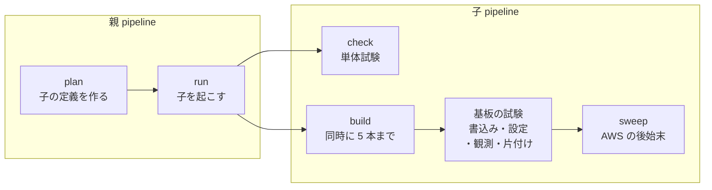

# CI/CD 運用

この repo の CI は、3 種類の基板（RX72N・RX65N・RX671）に実際にファームウェアを書き込み、AWS IoT Core へつないで 36 通りの試験を自動で行います。

- 試験は 36 通りです。基板 3 種 × TLS の実装 2 種（software と TSIP）× TLS 1.2 / 1.3 × 機能 3 種（MQTT・OTA・Fleet Provisioning）で、すべて実装済みです。
- どの試験を流すかは、pipeline を手で起こす時の変数で選びます。何も選ばなければ、CI の道具の単体試験だけが動きます。基板は使いません。
- 全体は親 pipeline と子 pipeline の 2 段です。親が子の定義を作って起こし、子が build・基板の試験・後始末を行います。
- 基板は 1 枚ずつ専用に使います。同じ基板の試験は同時に 1 本しか動きません。
- AWS に作った試験用の資源は、試験が終わるたびに消します。

[全 36 試験が 1 本の pipeline で通った実績](https://gitlab.saffti.jp/oss/import/github/renesas/iot-reference-rx/-/pipelines/17168)があります。

## 流れ

- `plan`: 変数を読み、流す試験を決めて、子 pipeline の定義（`child-pipeline.yml`）と選択の記録（`plan.json`）を作ります。選択が不正なら、理由を出して止まります。
- `run`: 子 pipeline を起こし、終わるまで待ちます。子の成否が親の成否になります。
- `check`: CI の道具の単体試験です。build と並行して動き、基板の試験の開始を待たせません。
- `build`: Windows の build 用 runner で、試験に必要なファームウェアを作ります。
- 基板の試験: 基板につないだ Raspberry Pi の runner で、1 試験につき 1 job が動きます。
- `sweep`: 基板の試験が成功しても失敗しても、取り消されても動き、AWS に残った試験用の thing を消します。

## 試験の一覧

試験の名前は `<基板>:<backend>:<tls>:<feature>` の形です。例は `rx72n:sw:tls12:mqtt` です。

| 軸 | 値 | 意味 |
|---|---|---|
| 基板 | `rx72n` | RX72N Envision Kit（Ethernet） |
| 基板 | `rx65n` | CK-RX65N V1 + BG96（Cellular） |
| 基板 | `rx671` | EK-RX671 + Type 1YN（Wi-Fi） |
| backend | `sw` | Mbed TLS によるソフトウェアの TLS |
| backend | `tsip` | TSIP（ハードウェア暗号）を使う TLS |
| tls | `tls12` / `tls13` | TLS の版 |
| feature | `mqtt` | AWS IoT Core へつないで publish する |
| feature | `ota` | AWS IoT の OTA で新しいファームウェアへ更新する |
| feature | `fleet` | Fleet Provisioning で証明書を受け取る |

| 基板・backend | TLS 1.2 | TLS 1.3 |
|---|---|---|
| `rx72n:sw` | mqtt・ota・fleet | mqtt・ota・fleet |
| `rx72n:tsip` | mqtt・ota・fleet | mqtt・ota・fleet |
| `rx65n:sw` | mqtt・ota・fleet | mqtt・ota・fleet |
| `rx65n:tsip` | mqtt・ota・fleet | mqtt・ota・fleet |
| `rx671:sw` | mqtt・ota・fleet | mqtt・ota・fleet |
| `rx671:tsip` | mqtt・ota・fleet | mqtt・ota・fleet |

- 6 行 × 2 列 × 3 機能で 36 試験です。一覧の正本は [`tools/ci/tests.json`](../tools/ci/tests.json) で、`python3 tools/ci/rxci.py list` で名前を確かめられます。
- `PROFILE=smoke` が流す試験は、各基板の `sw:tls12:mqtt` の 3 試験です（`tests.json` の `smoke`）。

## pipeline を手で起こす時の変数

**Build > Pipelines > New pipeline** の画面に、次の変数が既定の値つきで出ます。値はプルダウンで選びます。定義は [`.gitlab-ci.yml`](../.gitlab-ci.yml) の `variables` です。

| 変数 | 既定 | 選べる値 | 意味 |
|---|---|---|---|
| `PROFILE` | `check` | `check` / `build` / `smoke` / `full` / `doctor` | どこまで流すか |
| `BOARD` | `all` | `all` / `rx72n` / `rx65n` / `rx671` | 試験する基板 |
| `BACKEND` | `all` | `all` / `sw` / `tsip` | TLS の実装 |
| `TLS` | `all` | `all` / `tls12` / `tls13` | TLS の版 |
| `FEATURE` | `all` | `all` / `mqtt` / `ota` / `fleet` | 試験の種類 |
| `REPEAT` | `1` | `1` / `2` / `3` / `5` / `10` | 選んだ各試験を何回流すか。1 回ごとに 1 job |
| `REBUILD` | `false` | `false` / `true` | `true`: すべてのファームウェアを作り直す。`false`: 入力が同じ build を使い回す |
| `TEST` | 空 | 正規表現 | 上の 4 つの選択で書けない選び方のためだけに使う。試験の名前に対する正規表現 |

`PROFILE` の意味は次のとおりです。

| `PROFILE` | 動くもの |
|---|---|
| `check` | 単体試験だけ（基板も build も使わない） |
| `build` | 単体試験と、すべてのファームウェアの build（基板は使わない） |
| `smoke` | 単体試験、3 試験に必要な build、基板の 3 試験（各基板の `sw:tls12:mqtt`）、`sweep` |
| `full` | 単体試験、選んだ試験に必要な build、基板の試験、`sweep`。選択（`BOARD`・`BACKEND`・`TLS`・`FEATURE`・`TEST`）は、この値の時だけ使える |
| `doctor` | 各 runner が道具・Python module・AWS へのアクセスを持つかを表示する。基板にも触れず、AWS の資源も変えない |

### 目的ごとの変数の値と、動く job

| 目的 | `PROFILE` | 他の変数 | 動く job |
|---|---|---|---|
| CI の道具の単体試験だけ | `check` | なし | `check` |
| 基板なしで、すべてのファームウェアを build | `build` | なし | `check`、全 31 種類の build |
| 基板で少数の試験 | `smoke` | なし | `check`、build 6 本、基板の 3 試験、`sweep` |
| 基板ですべての試験 | `full` | なし | `check`、全 31 種類の build、基板の 36 試験、`sweep` |
| 1 つの基板の試験 | `full` | `BOARD=rx671` | `check`、必要な build、その基板の 12 試験、`sweep` |
| 1 種類の試験を全基板で | `full` | `FEATURE=ota`（`BACKEND`・`TLS` も同様） | `check`、必要な build、条件に合う試験、`sweep` |
| 1 つの試験を 3 回 | `full` | `BOARD=rx72n` `BACKEND=sw` `TLS=tls12` `FEATURE=mqtt` `REPEAT=3` | `check`、build 2 本、基板の試験 3 job（`#1`〜`#3`）、`sweep` |
| 4 つの選択で書けない選び方 | `full` | `TEST=^rx72n:(sw\|tsip):tls12:ota$`（4 つの選択は `all` のまま） | `check`、必要な build、名前が一致した試験、`sweep` |
| ファームウェアを作り直して試験 | `full` | `REBUILD=true` | build を使い回さず、すべて作り直す |
| runner が持っている物を見る | `doctor` | なし | `check`、runner ごとの `doctor: …` |

- 4 つの選択（`BOARD`・`BACKEND`・`TLS`・`FEATURE`）は、どれも `all` なら制限なし、値を選べばその値の試験だけを流します。複数の軸を選べば、すべてに合う試験だけです。
- 試験の数は、`BOARD` を 1 つ選ぶと 12、`BACKEND` か `TLS` を 1 つ選ぶと 18、`FEATURE` を 1 つ選ぶと 12 です。

### 止まる組み合わせ

合わない組み合わせは、`plan` が理由を出して止まります。基板にも AWS にも触れる前に止まるので、何も動かないのに緑になる pipeline は作られません。

| 指定 | 結果 |
|---|---|
| `PROFILE` が表に無い値 | `plan` が止まる |
| `BOARD`・`BACKEND`・`TLS`・`FEATURE` が選べる値に無い | `plan` が止まる |
| `PROFILE` が `full` 以外で、選択（4 つの選択か `TEST`）を指定 | `plan` が止まる（`PROFILE=full` にするか、選択を戻す） |
| `TEST` と、`all` 以外の 4 つの選択を同時に指定 | `plan` が止まる |
| `REPEAT` が 2 以上で、`PROFILE` が `full` と `smoke` 以外 | `plan` が止まる |
| `REPEAT` が 1 〜 50 の外 | `plan` が止まる（画面の選択肢は 1・2・3・5・10） |
| `TEST` に一致する試験が無い | `plan` が止まる |

## 起動元ごとの動き

[`.gitlab-ci.yml`](../.gitlab-ci.yml) の `workflow` の rules が、起動元ごとの既定を決めます。

| 起動元 | `PROFILE` | 備考 |
|---|---|---|
| merge request を開いている branch への push | pipeline を作らない | merge request の pipeline だけが動く |
| merge request の pipeline | `build` | 基板は使わない |
| 既定の branch（`main`）への push | `smoke` | 基板の 3 試験 |
| merge request を開いていない branch への push | `check`（画面の既定） | 単体試験だけ |
| schedule | `full`（`REBUILD=true`） | 新しい commit が来ても取り消さない |
| 手で起こす（web）・API | 選んだ値（既定は `check`） | 新しい commit が来ても取り消さない |
| tag | `check` | 下の注を参照 |

- tag の行は、`workflow` の rules から読み取った結果です。tag の pipeline では `CI_COMMIT_BRANCH` が空なので、どの rule にも一致せず、最後の「どれにも当たらない場合」の rule（`when: always`）で `variables` の既定（`PROFILE=check`）になります。tag を実際に push して確かめてはいません。
- 「取り消さない」は、`workflow` の `auto_cancel: on_new_commit: none` です。人や schedule が起こした実機の試験を、次の push が止めないためです。この時、子 pipeline にも同じ指定（内部の変数 `KEEP=true`）が渡ります。それ以外の pipeline では、新しい commit が来ると、古い pipeline の単体試験と build が取り消されます。基板を触っている試験 job は、取り消しの対象になりません。
- AWS を使う試験は、保護された変数 `AWS_ROLE_ARN` を使います。保護されていない branch の pipeline では、この変数が渡らず、AWS を使う job は理由を出して止まります（`rxci.py` のエラー文による）。

以降は基本的にAI向けの網羅的資料です。人間が読む必要はありません。
内容を確認したい場合は、最初にAIへ要約を依頼してください。

---

## 道具と file の役割

CI の定義と道具は、次の file に分かれています。何を流すかを決めるのは `tests.json` だけです。

| file | 役割 |
|---|---|
| [`.gitlab-ci.yml`](../.gitlab-ci.yml) | 既定の範囲を決め、子 pipeline を 1 本起こす。`plan` と `run` の 2 job だけを持つ |
| [`tools/ci/rxci.py`](../tools/ci/rxci.py) | 入口。`plan`（子 pipeline の定義を書く）、`list`、`doctor`、`build`、`test`、`finish`（試験 job の `after_script`）、`sweep` の各 command を持つ |
| [`tools/ci/rxci_build.py`](../tools/ci/rxci_build.py) | Windows の runner でのファームウェアの build と、build の使い回し |
| [`tools/ci/rxci_board.py`](../tools/ci/rxci_board.py) | 基板につないだ runner での、1 試験の流れ（排他・書き込み・設定・観測・片付け） |
| [`tools/ci/rxci_aws.py`](../tools/ci/rxci_aws.py) | AWS の試験用資源の作成と削除 |
| [`tools/ci/tests.json`](../tools/ci/tests.json) | 試験の一覧（軸の値・実装済みの試験・smoke の試験）、基板ごとの設定、runner の tag、build の同時数 |

- 子 pipeline の stage は `check`・`build`・`test`・`cleanup` です。試験 job は、必要な build job だけを `needs` で待ちます。
- AWS の API へは、GitLab が job ごとに発行する ID token（OIDC）で入ります。使う role は、保護された group 変数 `AWS_ROLE_ARN` が決めます。共通の設定は[ハードウェア構成の台帳](https://gitlab.saffti.jp/oss/infra/hardware-config/-/blob/main/docs/ci-variables.md)にあります。
- 基板側の道具は、仮想環境を runner の利用者ごとに作って使います。仮想環境は [`tools/ci/requirements.txt`](../tools/ci/requirements.txt) が変わった時だけ作り直します。
- 単体試験は `python3 -m unittest discover -s tools/ci -p 'test_rxci*.py'` で、`check` job が流します。

### 試験を足す時に変える所

1. [`tools/ci/tests.json`](../tools/ci/tests.json) の `axes` に値を足す（新しい基板なら `boards` に、基板の設定・runner の tag・`resource_group` も足す）。試験の名前と番号（`RXCI-001` から）は、4 つの軸の組み合わせから自動で作られます。
2. 同じ file の `ready` に、実装した試験の名前を足す。`ready` に無い試験は、選んでも実行されず、`plan` の表示に `todo` と出ます。選んだ試験がすべて `ready` に無いと、`plan` が止まります。
3. 必要なら `smoke` に足す。
4. [`tools/ci/rxci_board.py`](../tools/ci/rxci_board.py) の `RECIPES` に、（基板, 機能）の流れを足す。
5. build が新しいなら、[`tools/ci/rxci_build.py`](../tools/ci/rxci_build.py) に build の流れを足す。
6. [`.gitlab-ci.yml`](../.gitlab-ci.yml) の選択肢（`options`）も、軸の値と同じにする。単体試験が、この 2 つの一致を確かめます。
7. この文書の「試験の一覧」と「目的ごとの変数」の数を合わせる。

## build

- build は `build <基板>/<名前>` という名前の job です。`<名前>` は `common`（基板ごとに commit に 1 つ。provisioner の image と署名者の証明書・公開鍵。RX671 は boot loader も）、`software/app`・`software/fleet`・`software/ota`、`tsip-<tls>/<種類>` のように決まります。
- RX72N と RX65N の software は、1 つの build が TLS 1.2 と 1.3 の両方に使えます。TSIP は TLS の版を build に含めるので、`tsip-tls12` と `tsip-tls13` に分かれます。RX671 は software も TLS の版ごとです（`tests.json` の `software_build_per_tls`）。
- OTA の試験は、通常のアプリと、版を上げた更新用のファームウェアの両方が要ります。RX671 の OTA は、provisioner・boot loader・基準のアプリ・更新用のファームウェアを 1 つの build にまとめます。
- RX671 の TSIP の MQTT は、専用の build を持ちません。OTA の束（`tsip-<tls>/ota`）に入っている基準のアプリを使います。
- build の同時数は 5 本です（`tests.json` の `build_lanes`）。build を `resource_group`（`windows-ccrx-build-1`〜`-5`）に振り分けて、pipeline をまたいでも 5 本を超えないようにします。
- build の時間の上限は 50 分です。build の artifact は `out/<build の名前>/` で、3 日間残ります。

### build の使い回し

build は、入力が同じなら、前に作った物を使い回します。

- 入力は、commit に入っているファイル（依存する submodule は固定された commit で）、build の名前、`tests.json` の基板の設定、e² studio の command line の場所です。文書（`docs/`・`*.md`）、`.gitlab-ci.yml`、試験や基板側の道具など、build の結果を変えない物は入力に数えません。
- 使い回す物は、build 用 runner の作業用フォルダの `rxci-build-cache` に、入力から作った名前で置きます。古い順に消し、80 件を残します。
- 認証情報を含む image（RX671 の `app` と `fleet`）は、使い回しません。毎回作り、暗号化して artifact にします。
- `REBUILD=true`、または schedule の pipeline は、使い回さず、作り直して置き換えます。コンパイラや e² studio を同じ場所のまま更新した時は、`REBUILD=true` で 1 回流します。

## 基板の排他

- 基板ごとに `resource_group`（`board-rx72n`・`board-rx65n`・`board-rx671`）を持ちます。1 枚の基板で同時に動く試験は 1 本だけです。
- `resource_group` は GitLab の中だけの排他です。このため、試験の process は、基板をつないだ Raspberry Pi 上の基板ごとの lock file（`tools/idt/targets.json` の `bench_lock`）も取ります。lock を取れるまで最長 3000 秒待ちます。lock は process が終わると自動で外れます。基板と違う host の runner では、試験は始まりません。
- 試験 job の時間の上限は 40 分です。試験 job は、取り消されない設定（`interruptible: false`）です。

## 基板ごとの試験の流れ

どの試験も、基板の lock を取り、書き込み・設定・観測を行い、最後に片付けます。

共通の書き込み（`install`）の手順です。

1. チップ全体を消す。
2. provisioner を書き、署名者の公開鍵を基板に格納する。
3. boot loader を書く（bank 1 用の boot loader がある基板は、それも書く）。
4. 署名つきのアプリを、boot loader へ UART で送る。

基板ごとの違いです。

| 基板 | 書き込み・設定 | 観測 | AWS 側の資源 |
|---|---|---|---|
| RX72N | 共通の書き込み。UART の CLI で、device の証明書・鍵・接続先を設定する | UART のログで MQTT・Fleet・OTA を観測する | MQTT は固定の thing と証明書。Fleet は claim 証明書で作られた thing を、試験の後で削除。OTA は試験専用の thing を作り、OTA の更新・job・S3 のファイルとともに削除 |
| RX65N | 共通の書き込み。Cellular 用の設定（APN・接続先・証明書）を、専用の道具で入れる | UART のログで、Cellular への接続と MQTT・Fleet・OTA を観測する | software の MQTT と OTA は、試験ごとに thing と証明書を作って削除。TSIP の MQTT は固定の thing。TSIP の OTA は、固定の thing の証明書をひも付けた試験専用の thing を作って削除 |
| RX671 | software の MQTT と Fleet は、Wi-Fi と AWS の認証情報を build に入れたアプリ（暗号化して受け渡す）を書く。OTA は、認証情報を build に入れず、provisioner 経由で基板に入れる | UART のログで、Wi-Fi・MQTT・Fleet・OTA を観測する | software の OTA は、試験ごとに thing と証明書を作って削除。TSIP は固定の thing |

TSIP の試験では、次の決まりがあります。

- 秘密鍵は、平文のまま基板に渡しません。TSIP 用に包んだ鍵（wrapped key）を、別の手順で UART から送ります。
- 包んだ鍵は、基板に固定の証明書に結びついています。このため、TSIP の試験は、試験ごとに作った証明書を使えません。基板に固定の thing と証明書（CI 変数）を使います。
- RX671 の TSIP の MQTT は、専用の build を使わず、OTA の束から起こします。基準のアプリを書き、provisioner 経由で Wi-Fi・接続先・固定の証明書・包んだ鍵を入れて、MQTT を観測します。

RX671 で認証情報を含むアプリを書いた試験は、終わりにアプリの領域を消します。OTA や TSIP の試験は、Wi-Fi のパスフレーズと鍵を持つ data flash があるため、終わりにチップ全体を消します。

## AWS の試験用資源と `sweep`

- 試験が作る thing は、名前が `rxci-p<pipeline>-j<job>-<ラベル>` の形で、持ち主の pipeline と job が分かります。名前だけで後始末ができるので、取り消された pipeline の分も消せます。
- `sweep` job は、子 pipeline の最後に動きます（`when: always`）。自分の pipeline の名前の thing と、6 時間より古い、どの pipeline の thing も、証明書とともに削除します。基板の試験を 1 つも含まない pipeline には、この job は入りません。
- Fleet Provisioning で基板が作った thing と証明書は、名前を template が決めます。試験の道具が、基板から報告された名前を、集計の file に書いておき、試験の最後に削除します。
- OTA の更新・job・S3 のファイル・OTA 用の専用の thing は、試験の最後に削除します。名前が `rxci-p` で始まらない物があるため、`sweep` の対象ではなく、試験が記録した file を元に削除します。
- 試験の process が終わりまで動けなかった時（取り消し・時間切れ）は、`after_script`（`rxci.py finish`）が、同じ後始末をやり直します。基板が別の job に使われている時は、基板を触りません。

## 試験のあとの基板

- 片付けるのが原則です。試験が終わると、基板をリセットのまま止めます（`park`）。次の試験まで、基板は静かにしています。
- 例外は RX72N だけです。RX72N は表示があるため、試験のあとも動かしたままにして、人が表示で動きを確かめられるようにします（`tests.json` の `keep_running_after_test`）。
- 試験の process は、終了前に `out/logs/finished` を書きます。この file が無い時だけ、`after_script` が後始末をやり直します。

## 落ちた時に見る file

試験 job の artifact は `out/logs/` に 14 日間残ります。

| file | 内容 |
|---|---|
| `junit.xml` | 試験の成否と、失敗の理由 1 行（GitLab の画面の Tests に出る） |
| `observe.log` | UART の観測の全文 |
| `uart-download.log` | boot loader へアプリを送った記録 |
| `provision_summary.json`・`fleet_summary.json` | 設定・Fleet の結果の記録 |
| `ota/` | OTA の記録（UART の生ログ `ota_uart_raw.log`、結果 `ota_summary.json`、AWS 側の状態） |
| `provisioner/` | 共通の書き込みで、provisioner が出した記録 |
| `uart.log`・`uart-junit.xml` | RX671 の MQTT の観測 |
| `finished` | 試験の process が片付けまで終えた印 |

build job の artifact は `out/<build の名前>/` で、`e2studio_build.log`、リンカの map、使い回した build の元の job を書いた `build.json` が入ります。`plan` job の artifact は `child-pipeline.yml` と `plan.json`（選んだ試験と build の一覧）で、14 日間残ります。

- build が落ちた時は、job の log に、リンカの異常を示す行が出ます。
- 子 pipeline が始まらない時は、`plan` job の log に、止まった理由が出ます。

## 使う CI 変数の名前

値は書きません。正本は[ハードウェア構成の台帳（CI 変数）](https://gitlab.saffti.jp/oss/infra/hardware-config/-/blob/main/docs/ci-variables.md)です。この表は、`tests.json` と `tools/ci/rxci*.py` が参照する名前だけを、用途で分けて並べます。

| 用途 | 変数の名前 |
|---|---|
| AWS への入り口 | `AWS_ROLE_ARN`、`AWS_IOT_ENDPOINT`（TLS 1.2 の接続先。TLS 1.3 の接続先は `tests.json` の `endpoints`） |
| RX72N の device | `AWS_CLIENT_CERT_RX72N_02`、`AWS_PRIVATE_KEY_RX72N_02` |
| Fleet Provisioning | `AWS_FLEET_PROVISIONING_TEMPLATE_RX72N_02`、`AWS_FLEET_CLAIM_CERT_RX72N_02`、`AWS_FLEET_CLAIM_PRIVATE_KEY_RX72N_02` |
| OTA | `AWS_OTA_S3_BUCKET_RX72N_02`、`AWS_OTA_SIGNING_PROFILE_RX72N_02`、`AWS_OTA_SERVICE_ROLE_ARN_RX72N_02` |
| RX65N の TSIP | `AWS_IOT_THING_NAME_CK_RX65N_01` |
| RX671 の認証情報 | `RX671_EK_WIFI_SSID`、`RX671_EK_WIFI_PASSPHRASE`、`RX671_EK_AWS_IOT_THING_NAME`、`RX671_EK_AWS_IOT_CERT_PEM`、`RX671_EK_AWS_IOT_PRIVATE_KEY_PEM`、`RX671_EK_AWS_IOT_ENDPOINT`（任意） |
| RX671 の TSIP | `RX671_TSIP_AWS_IOT_THING_NAME`、`RX671_TSIP_LANBENCH_CLIENT_CERT_PEM` |

- 認証情報を含む RX671 のアプリは、build 側と試験側がともに持つ File 型の変数（`RX671_EK_AWS_IOT_PRIVATE_KEY_PEM`・`AWS_FLEET_CLAIM_PRIVATE_KEY_RX72N_02`）から鍵を導き、アプリを暗号化して受け渡します。
- e² studio の command line の場所は、環境変数 `E2STUDIO_CLI` があればそれを、なければ `tests.json` の `e2studio_cli` を使います。

## 古い CI との関係

この文書は、`PROFILE` を中心にした新しい CI だけを説明します。古い CI の変数（`PIPELINE_PROFILE`、基板ごとの `*_TEST_SCOPE`、`RUN_RX_IDT` など）と job（基板・機能ごとに分かれた `build_…`・`flash_…`・`test_…`）は、この CI にはありません。手で pipeline を起こす時は、上の変数だけを使います。古い変数を指定しても、`plan` は読まず、黙って無視します。変更の要約は [Changelog](../Changelog.md) にあります。
