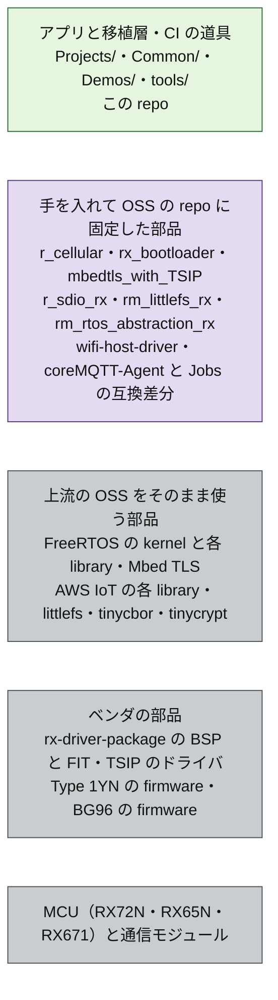

# 試験仕様

[[_TOC_]]

この repo の CI は、3 種類の基板（RX72N・RX65N・RX671）に実際にファームウェアを書き込み、AWS IoT Core へつないで 36 項目の試験を行います。この文書は、36 項目の 1 つずつのテスト番号、期待値、対象外、確かめる試験と、合否の基準を定めます。運用（pipeline を起こす変数、落ちた時に見る file）は [CI/CD 運用](details/ci-pipeline.md)にあります。

- 試験は、機能 3 種（MQTT・OTA・Fleet Provisioning）× 基板 3 種 × TLS の実装 2 種（software・TSIP）× TLS の版 2 種（1.2・1.3）の 36 項目です。機能の決め方は[機能仕様書](architecture.md#2-機能と実装仕様書)にあります。
- テスト番号は `IREF-MQTT-001` の形です。一覧は[テスト項目の一覧](#テスト項目の一覧)にあります。
- 合否は、基板の UART に出るログの行で決めます。AWS 側の状態（OTA の job の状態、thing の登録内容）は、合否に使いません。AWS 側は、試験が資源を作り、終わりに消すだけです。
- 36 項目を各 3 回流して全部が通った記録が、[pipeline 17303](https://gitlab.saffti.jp/oss/import/github/renesas/iot-reference-rx/-/pipelines/17303) です。結果は[全体の試験結果](details/validation/all-test-results.md)にあります。

| 基板・backend | TLS 1.2 | TLS 1.3 |
|---|---|---|
| RX72N（Ethernet）・software | MQTT・OTA・Fleet | MQTT・OTA・Fleet |
| RX72N・TSIP | MQTT・OTA・Fleet | MQTT・OTA・Fleet |
| RX65N（Cellular）・software | MQTT・OTA・Fleet | MQTT・OTA・Fleet |
| RX65N・TSIP | MQTT・OTA・Fleet | MQTT・OTA・Fleet |
| RX671（Wi-Fi）・software | MQTT・OTA・Fleet | MQTT・OTA・Fleet |
| RX671・TSIP | MQTT・OTA・Fleet | MQTT・OTA・Fleet |

以降は基本的にAI向けの網羅的資料です。人間が読む必要はありません。
内容を確認したい場合は、最初にAIへ要約を依頼してください。

---

## 位置づけ

- 試験項目は、[機能仕様書](architecture.md)の要求と、機能ごとの実装仕様書（[MQTT](details/mqtt.md)・[OTA](details/ota.md)・[Fleet Provisioning](details/fleet-provisioning.md)）の決まりから導きます。決まりごとに、どのテスト番号で確かめるか、確かめない所は何かを、各実装仕様書の「決まりと試験の対応」に書きます。
- 対象は、`tools/ci/tests.json` の `ready` に載る 36 項目です。1 項目は、`tools/ci/rxci.py` の `test` が行う 1 回の流れ（書き込み・設定・観測・片付け）で、GitLab の pipeline では、名前が同じ 1 つの job です。
- 流れを定めるのは [`tools/ci/rxci_board.py`](../tools/ci/rxci_board.py) の `RECIPES`（基板 × 機能の 9 通り）です。観測して合否を決める道具は、`RECIPES` が起こす別の道具です。
- 子 pipeline の `check` job は、CI の道具自体の単体試験（`tools/ci/test_rxci*.py`）です。基板も AWS も使わず、この 36 項目には数えません。
- この repo のコンポーネントコードは `IREF` です。この repo の試験仕様書は、この文書 1 つです。
- 通信性能のベンチマークは、この repo の試験ではありません。`PROFILE=full` の時に、この repo の CI が別の project の pipeline を起こして測ります。起こす project と測る物は [CI/CD 運用のベンチマークの節](details/ci-pipeline.md#ベンチマークの-project)にあり、各 project の測り方と合否はその project の文書にあります。

### ソフトウェアスタックと責任の区分

| 色 | 区分 | 部品 | 個別の試験 | 問題が出たときの最初の動き |
|---|---|---|---|---|
| 緑 | 自社開発 | この repo のアプリ、移植層、CI の道具 | この文書の 36 項目。CI の道具は単体試験 | 自分たちで調べる |
| 紫 | OSS・中を確かめた | 手を入れて OSS の repo に固定した部品 | `r_cellular` は自分の試験の repo を持つ。ほかは、この文書の 36 項目で結合して確かめる | 自分たちで中を調べる |
| 灰 | ブラックボックス | 上流の OSS をそのまま使う部品、ベンダの部品、MCU と通信モジュール | 持たない。この文書の 36 項目で結合して確かめる | 上流またはベンダに問い合わせる |

部品の一覧は [`.gitmodules`](../.gitmodules) と、[機能仕様書のコードの地図](architecture.md#8-コードの地図c4-の-4-段目)にあります。

## テスト番号の体系

- テスト番号は `IREF-<仕様書キー>-<連番 3 桁>` です。仕様書キーは `MQTT`・`OTA`・`FLEET` で、実装仕様書 1 つに 1 つです。決め方は[機能仕様書のテスト番号の体系](architecture.md#23-テスト番号の体系)にあります。
- 番号は [`tools/ci/tests.json`](../tools/ci/tests.json) の `ids` に書いて固定しています。`python3 tools/ci/rxci.py list` で、番号と名前の対応を表示できます。
- 名前は `<基板>:<backend>:<tls>:<feature>` です（例: `rx72n:sw:tls12:mqtt`）。`<backend>` は `sw`（Mbed TLS）と `tsip`（TSIP）です。CI の job の名前は、この名前です。
- pipeline で試験を選ぶ変数は、[CI/CD 運用](details/ci-pipeline.md#pipeline-を手で起こす時の変数)にあります。

| 仕様書キー | 大分類 | 中分類 | 件数 | 実装仕様書 |
|---|---|---|---:|---|
| `MQTT` | `FUNC` | `OP` | 12 | [details/mqtt.md](details/mqtt.md) |
| `OTA` | `FUNC` | `OP` | 12 | [details/ota.md](details/ota.md) |
| `FLEET` | `FUNC` | `OP` | 12 | [details/fleet-provisioning.md](details/fleet-provisioning.md) |

分類は、36 項目すべてが大分類 `FUNC`・中分類 `OP`（AWS IoT Core を相手にした操作とその結果）です。

## テスト項目の一覧

36 項目は、すべて実装済み（`ready`）で、状態は「正式」です。`smoke` の項目は、`IREF-MQTT-001`・`IREF-MQTT-005`・`IREF-MQTT-009`（各基板の `sw:tls12:mqtt`）です。期待値の詳しい行の文字列は、[合否の基準](#合否の基準)の各節にあります。

| テスト番号 | 大分類 | 中分類 | 項目 | 期待値 | 対象外 | 確かめる試験と CI の job | 状態 |
|---|---|---|---|---|---|---|---|
| `IREF-MQTT-001` | `FUNC` | `OP` | RX72N・software・TLS 1.2 で、Ethernet から AWS IoT Core へ接続し、topic を購読して publish する | 4 つの行（IP Address・購読・publish・$aws/things/ の受信）がそろう。出た TLS の版の行がすべて TLS 1.2（[M1](#m1-rx72n-の-mqtt)） | publish が AWS IoT に届いた事。エラーの行 | `mqtt_rx72n` / `rx72n:sw:tls12:mqtt` | 正式 |
| `IREF-MQTT-002` | `FUNC` | `OP` | RX72N・software・TLS 1.3 で、Ethernet から AWS IoT Core へ接続し、topic を購読して publish する | 4 つの行（IP Address・購読・publish・$aws/things/ の受信）がそろう。出た TLS の版の行がすべて TLS 1.3（[M1](#m1-rx72n-の-mqtt)） | publish が AWS IoT に届いた事。エラーの行 | `mqtt_rx72n` / `rx72n:sw:tls13:mqtt` | 正式 |
| `IREF-MQTT-003` | `FUNC` | `OP` | RX72N・TSIP・TLS 1.2 で、Ethernet から AWS IoT Core へ接続し、topic を購読して publish する | 4 つの行（IP Address・購読・publish・$aws/things/ の受信）がそろう。出た TLS の版の行がすべて TLS 1.2（[M1](#m1-rx72n-の-mqtt)） | publish が AWS IoT に届いた事。エラーの行 | `mqtt_rx72n` / `rx72n:tsip:tls12:mqtt` | 正式 |
| `IREF-MQTT-004` | `FUNC` | `OP` | RX72N・TSIP・TLS 1.3 で、Ethernet から AWS IoT Core へ接続し、topic を購読して publish する | 4 つの行（IP Address・購読・publish・$aws/things/ の受信）がそろう。出た TLS の版の行がすべて TLS 1.3（[M1](#m1-rx72n-の-mqtt)） | publish が AWS IoT に届いた事。エラーの行 | `mqtt_rx72n` / `rx72n:tsip:tls13:mqtt` | 正式 |
| `IREF-MQTT-005` | `FUNC` | `OP` | RX65N・software・TLS 1.2 で、Cellular（BG96）から AWS IoT Core へ接続し、topic を購読して publish する | publish の行と、購読か PubSub の終わりの行がある。出た TLS の版の行がすべて TLS 1.2（[M2](#m2-rx65n-の-mqtt)） | publish が AWS IoT に届いた事 | `mqtt_rx65n` / `rx65n:sw:tls12:mqtt` | 正式 |
| `IREF-MQTT-006` | `FUNC` | `OP` | RX65N・software・TLS 1.3 で、Cellular（BG96）から AWS IoT Core へ接続し、topic を購読して publish する | publish の行と、購読か PubSub の終わりの行がある。出た TLS の版の行がすべて TLS 1.3（[M2](#m2-rx65n-の-mqtt)） | publish が AWS IoT に届いた事 | `mqtt_rx65n` / `rx65n:sw:tls13:mqtt` | 正式 |
| `IREF-MQTT-007` | `FUNC` | `OP` | RX65N・TSIP・TLS 1.2 で、Cellular（BG96）から AWS IoT Core へ接続し、topic を購読して publish する | publish の行と、購読か PubSub の終わりの行がある。出た TLS の版の行がすべて TLS 1.2（[M2](#m2-rx65n-の-mqtt)） | publish が AWS IoT に届いた事 | `mqtt_rx65n` / `rx65n:tsip:tls12:mqtt` | 正式 |
| `IREF-MQTT-008` | `FUNC` | `OP` | RX65N・TSIP・TLS 1.3 で、Cellular（BG96）から AWS IoT Core へ接続し、topic を購読して publish する | publish の行と、購読か PubSub の終わりの行がある。出た TLS の版の行がすべて TLS 1.3（[M2](#m2-rx65n-の-mqtt)） | publish が AWS IoT に届いた事 | `mqtt_rx65n` / `rx65n:tsip:tls13:mqtt` | 正式 |
| `IREF-MQTT-009` | `FUNC` | `OP` | RX671・software・TLS 1.2 で、Wi-Fi（Type 1YN）から AWS IoT Core へ接続し、publish する | Wi-Fi の join、network、`AWS TLS=0`・`AWS MQTT=0` の行がそろう。出た TLS の版の行がすべて TLS 1.2（[M3](#m3-rx671-software-の-mqtt)） | topic の購読（smoke のアプリは購読しない） | `mqtt_rx671` / `rx671:sw:tls12:mqtt` | 正式 |
| `IREF-MQTT-010` | `FUNC` | `OP` | RX671・software・TLS 1.3 で、Wi-Fi（Type 1YN）から AWS IoT Core へ接続し、publish する | Wi-Fi の join、network、`AWS TLS=0`・`AWS MQTT=0` の行がそろう。出た TLS の版の行がすべて TLS 1.3（[M3](#m3-rx671-software-の-mqtt)） | topic の購読（smoke のアプリは購読しない） | `mqtt_rx671` / `rx671:sw:tls13:mqtt` | 正式 |
| `IREF-MQTT-011` | `FUNC` | `OP` | RX671・TSIP・TLS 1.2 で、Wi-Fi（Type 1YN）から MQTT agent が AWS IoT Core へ接続し、最初の job の要求まで進む | Wi-Fi の join、network、MQTT の接続、job の要求の行がそろう。出た TLS の版の行がすべて TLS 1.2（[M4](#m4-rx671-tsip-の-mqtt)） | topic の購読と publish（基準のアプリは PubSub を持たない） | `mqtt_rx671_tsip` / `rx671:tsip:tls12:mqtt` | 正式 |
| `IREF-MQTT-012` | `FUNC` | `OP` | RX671・TSIP・TLS 1.3 で、Wi-Fi（Type 1YN）から MQTT agent が AWS IoT Core へ接続し、最初の job の要求まで進む | Wi-Fi の join、network、MQTT の接続、job の要求の行がそろう。出た TLS の版の行がすべて TLS 1.3（[M4](#m4-rx671-tsip-の-mqtt)） | topic の購読と publish（基準のアプリは PubSub を持たない） | `mqtt_rx671_tsip` / `rx671:tsip:tls13:mqtt` | 正式 |
| `IREF-OTA-001` | `FUNC` | `OP` | RX72N・software・TLS 1.2 で、Ethernet から AWS IoT の OTA で新しい版を受け取り、その版で起動する | OTA の判定（共通）の 4 つの証明のどれかが成り立ち、更新後の版 0.9.3 で起動する。出た TLS の版の行がすべて TLS 1.2（[O1](#o1-rx72n-の-ota)） | 同じ版・古い版・署名が合わない image を拒む事。AWS 側の job の状態。更新後の資源の余裕 | `ota_rx72n` / `rx72n:sw:tls12:ota` | 正式 |
| `IREF-OTA-002` | `FUNC` | `OP` | RX72N・software・TLS 1.3 で、Ethernet から AWS IoT の OTA で新しい版を受け取り、その版で起動する | OTA の判定（共通）の 4 つの証明のどれかが成り立ち、更新後の版 0.9.3 で起動する。出た TLS の版の行がすべて TLS 1.3（[O1](#o1-rx72n-の-ota)） | 同じ版・古い版・署名が合わない image を拒む事。AWS 側の job の状態。更新後の資源の余裕 | `ota_rx72n` / `rx72n:sw:tls13:ota` | 正式 |
| `IREF-OTA-003` | `FUNC` | `OP` | RX72N・TSIP・TLS 1.2 で、Ethernet から AWS IoT の OTA で新しい版を受け取り、その版で起動する | OTA の判定（共通）の 4 つの証明のどれかが成り立ち、更新後の版 0.9.3 で起動する。出た TLS の版の行がすべて TLS 1.2（[O1](#o1-rx72n-の-ota)） | 同じ版・古い版・署名が合わない image を拒む事。AWS 側の job の状態。更新後の資源の余裕 | `ota_rx72n` / `rx72n:tsip:tls12:ota` | 正式 |
| `IREF-OTA-004` | `FUNC` | `OP` | RX72N・TSIP・TLS 1.3 で、Ethernet から AWS IoT の OTA で新しい版を受け取り、その版で起動する | OTA の判定（共通）の 4 つの証明のどれかが成り立ち、更新後の版 0.9.3 で起動する。出た TLS の版の行がすべて TLS 1.3（[O1](#o1-rx72n-の-ota)） | 同じ版・古い版・署名が合わない image を拒む事。AWS 側の job の状態。更新後の資源の余裕 | `ota_rx72n` / `rx72n:tsip:tls13:ota` | 正式 |
| `IREF-OTA-005` | `FUNC` | `OP` | RX65N・software・TLS 1.2 で、Cellular（BG96）から AWS IoT の OTA で新しい版を受け取り、その版で起動する | 5 つの印と受理の印があり、更新後の版 0.9.99 で起動し、O2 に挙げた致命のエラー文字列が無い（再試行の対象の `Cellular init failed`・`Cellular Open Failed` は除く）。出た TLS の版の行がすべて TLS 1.2（[O2](#o2-rx65n-の-ota)） | 同じ版・古い版・署名が合わない image を拒む事。AWS 側の job の状態。更新後の資源の余裕 | `ota_rx65n` / `rx65n:sw:tls12:ota` | 正式 |
| `IREF-OTA-006` | `FUNC` | `OP` | RX65N・software・TLS 1.3 で、Cellular（BG96）から AWS IoT の OTA で新しい版を受け取り、その版で起動する | 5 つの印と受理の印があり、更新後の版 0.9.99 で起動し、O2 に挙げた致命のエラー文字列が無い（再試行の対象の `Cellular init failed`・`Cellular Open Failed` は除く）。出た TLS の版の行がすべて TLS 1.3（[O2](#o2-rx65n-の-ota)） | 同じ版・古い版・署名が合わない image を拒む事。AWS 側の job の状態。更新後の資源の余裕 | `ota_rx65n` / `rx65n:sw:tls13:ota` | 正式 |
| `IREF-OTA-007` | `FUNC` | `OP` | RX65N・TSIP・TLS 1.2 で、Cellular（BG96）から AWS IoT の OTA で新しい版を受け取り、その版で起動する | 5 つの印と受理の印があり、更新後の版 0.9.99 で起動し、O2 に挙げた致命のエラー文字列が無い（再試行の対象の `Cellular init failed`・`Cellular Open Failed` は除く）。出た TLS の版の行がすべて TLS 1.2（[O2](#o2-rx65n-の-ota)） | 同じ版・古い版・署名が合わない image を拒む事。AWS 側の job の状態。更新後の資源の余裕 | `ota_rx65n` / `rx65n:tsip:tls12:ota` | 正式 |
| `IREF-OTA-008` | `FUNC` | `OP` | RX65N・TSIP・TLS 1.3 で、Cellular（BG96）から AWS IoT の OTA で新しい版を受け取り、その版で起動する | 5 つの印と受理の印があり、更新後の版 0.9.99 で起動し、O2 に挙げた致命のエラー文字列が無い（再試行の対象の `Cellular init failed`・`Cellular Open Failed` は除く）。出た TLS の版の行がすべて TLS 1.3（[O2](#o2-rx65n-の-ota)） | 同じ版・古い版・署名が合わない image を拒む事。AWS 側の job の状態。更新後の資源の余裕 | `ota_rx65n` / `rx65n:tsip:tls13:ota` | 正式 |
| `IREF-OTA-009` | `FUNC` | `OP` | RX671・software・TLS 1.2 で、Wi-Fi（Type 1YN）から AWS IoT の OTA で新しい版を受け取り、その版で起動する | boot loader の印、OTA の判定（共通）と完了の印、更新前後の handshake、更新後の資源の余裕の閾値を満たし、版 0.1.1 で起動する。出た TLS の版の行がすべて TLS 1.2（[O3](#o3-rx671-の-ota)） | 同じ版・古い版・署名が合わない image を拒む事。AWS 側の job の状態 | `ota_rx671` / `rx671:sw:tls12:ota` | 正式 |
| `IREF-OTA-010` | `FUNC` | `OP` | RX671・software・TLS 1.3 で、Wi-Fi（Type 1YN）から AWS IoT の OTA で新しい版を受け取り、その版で起動する | boot loader の印、OTA の判定（共通）と完了の印、更新前後の handshake、更新後の資源の余裕の閾値を満たし、版 0.1.1 で起動する。出た TLS の版の行がすべて TLS 1.3（[O3](#o3-rx671-の-ota)） | 同じ版・古い版・署名が合わない image を拒む事。AWS 側の job の状態 | `ota_rx671` / `rx671:sw:tls13:ota` | 正式 |
| `IREF-OTA-011` | `FUNC` | `OP` | RX671・TSIP・TLS 1.2 で、Wi-Fi（Type 1YN）から AWS IoT の OTA で新しい版を受け取り、その版で起動する | boot loader の印、OTA の判定（共通）と完了の印、更新前後の handshake、更新後の資源の余裕の閾値を満たし、版 0.1.1 で起動する。出た TLS の版の行がすべて TLS 1.2（[O3](#o3-rx671-の-ota)） | 同じ版・古い版・署名が合わない image を拒む事。AWS 側の job の状態 | `ota_rx671` / `rx671:tsip:tls12:ota` | 正式 |
| `IREF-OTA-012` | `FUNC` | `OP` | RX671・TSIP・TLS 1.3 で、Wi-Fi（Type 1YN）から AWS IoT の OTA で新しい版を受け取り、その版で起動する | boot loader の印、OTA の判定（共通）と完了の印、更新前後の handshake、更新後の資源の余裕の閾値を満たし、版 0.1.1 で起動する。出た TLS の版の行がすべて TLS 1.3（[O3](#o3-rx671-の-ota)） | 同じ版・古い版・署名が合わない image を拒む事。AWS 側の job の状態 | `ota_rx671` / `rx671:tsip:tls13:ota` | 正式 |
| `IREF-FLEET-001` | `FUNC` | `OP` | RX72N・software・TLS 1.2 で、Ethernet から Fleet Provisioning を行い、証明書と thing の名前を受け取り、その証明書で接続し直す | 5 つの印がそろい、機密の payload が UART に出ない。出た TLS の版の行がすべて TLS 1.2（[F1](#f1-rx72n-の-fleet-provisioning)） | AWS 側に作られた thing と証明書の中身。template の異常などの異常系 | `fleet_rx72n` / `rx72n:sw:tls12:fleet` | 正式 |
| `IREF-FLEET-002` | `FUNC` | `OP` | RX72N・software・TLS 1.3 で、Ethernet から Fleet Provisioning を行い、証明書と thing の名前を受け取り、その証明書で接続し直す | 5 つの印がそろい、機密の payload が UART に出ない。出た TLS の版の行がすべて TLS 1.3（[F1](#f1-rx72n-の-fleet-provisioning)） | AWS 側に作られた thing と証明書の中身。template の異常などの異常系 | `fleet_rx72n` / `rx72n:sw:tls13:fleet` | 正式 |
| `IREF-FLEET-003` | `FUNC` | `OP` | RX72N・TSIP・TLS 1.2 で、Ethernet から Fleet Provisioning を行い、証明書と thing の名前を受け取り、その証明書で接続し直す | 5 つの印がそろい、機密の payload が UART に出ない。出た TLS の版の行がすべて TLS 1.2（[F1](#f1-rx72n-の-fleet-provisioning)） | AWS 側に作られた thing と証明書の中身。template の異常などの異常系 | `fleet_rx72n` / `rx72n:tsip:tls12:fleet` | 正式 |
| `IREF-FLEET-004` | `FUNC` | `OP` | RX72N・TSIP・TLS 1.3 で、Ethernet から Fleet Provisioning を行い、証明書と thing の名前を受け取り、その証明書で接続し直す | 5 つの印がそろい、機密の payload が UART に出ない。出た TLS の版の行がすべて TLS 1.3（[F1](#f1-rx72n-の-fleet-provisioning)） | AWS 側に作られた thing と証明書の中身。template の異常などの異常系 | `fleet_rx72n` / `rx72n:tsip:tls13:fleet` | 正式 |
| `IREF-FLEET-005` | `FUNC` | `OP` | RX65N・software・TLS 1.2 で、Cellular（BG96）から Fleet Provisioning を行い、証明書と thing の名前を受け取り、その証明書で接続し直す | 5 つの印がそろい、機密の payload が UART に出ない。出た TLS の版の行がすべて TLS 1.2（[F2](#f2-rx65n-の-fleet-provisioning)） | AWS 側に作られた thing と証明書の中身。template の異常などの異常系 | `fleet_rx65n` / `rx65n:sw:tls12:fleet` | 正式 |
| `IREF-FLEET-006` | `FUNC` | `OP` | RX65N・software・TLS 1.3 で、Cellular（BG96）から Fleet Provisioning を行い、証明書と thing の名前を受け取り、その証明書で接続し直す | 5 つの印がそろい、機密の payload が UART に出ない。出た TLS の版の行がすべて TLS 1.3（[F2](#f2-rx65n-の-fleet-provisioning)） | AWS 側に作られた thing と証明書の中身。template の異常などの異常系 | `fleet_rx65n` / `rx65n:sw:tls13:fleet` | 正式 |
| `IREF-FLEET-007` | `FUNC` | `OP` | RX65N・TSIP・TLS 1.2 で、Cellular（BG96）から Fleet Provisioning を行い、証明書と thing の名前を受け取り、その証明書で接続し直す | 5 つの印がそろい、機密の payload が UART に出ない。出た TLS の版の行がすべて TLS 1.2（[F2](#f2-rx65n-の-fleet-provisioning)） | AWS 側に作られた thing と証明書の中身。template の異常などの異常系 | `fleet_rx65n` / `rx65n:tsip:tls12:fleet` | 正式 |
| `IREF-FLEET-008` | `FUNC` | `OP` | RX65N・TSIP・TLS 1.3 で、Cellular（BG96）から Fleet Provisioning を行い、証明書と thing の名前を受け取り、その証明書で接続し直す | 5 つの印がそろい、機密の payload が UART に出ない。出た TLS の版の行がすべて TLS 1.3（[F2](#f2-rx65n-の-fleet-provisioning)） | AWS 側に作られた thing と証明書の中身。template の異常などの異常系 | `fleet_rx65n` / `rx65n:tsip:tls13:fleet` | 正式 |
| `IREF-FLEET-009` | `FUNC` | `OP` | RX671・software・TLS 1.2 で、Wi-Fi（Type 1YN）から Fleet Provisioning を行い、証明書と thing の名前を受け取り、その証明書で接続し直す | 5 つの印がそろい、機密の payload が UART に出ない。handshake の行が 2 件以上。出た TLS の版の行がすべて TLS 1.2（[F3](#f3-rx671-の-fleet-provisioning)） | AWS 側に作られた thing と証明書の中身。template の異常などの異常系 | `fleet_rx671` / `rx671:sw:tls12:fleet` | 正式 |
| `IREF-FLEET-010` | `FUNC` | `OP` | RX671・software・TLS 1.3 で、Wi-Fi（Type 1YN）から Fleet Provisioning を行い、証明書と thing の名前を受け取り、その証明書で接続し直す | 5 つの印がそろい、機密の payload が UART に出ない。handshake の行が 2 件以上。出た TLS の版の行がすべて TLS 1.3（[F3](#f3-rx671-の-fleet-provisioning)） | AWS 側に作られた thing と証明書の中身。template の異常などの異常系 | `fleet_rx671` / `rx671:sw:tls13:fleet` | 正式 |
| `IREF-FLEET-011` | `FUNC` | `OP` | RX671・TSIP・TLS 1.2 で、Wi-Fi（Type 1YN）から Fleet Provisioning を行い、証明書と thing の名前を受け取り、その証明書で接続し直す | 5 つの印がそろい、機密の payload が UART に出ない。handshake の行が 2 件以上。出た TLS の版の行がすべて TLS 1.2（[F3](#f3-rx671-の-fleet-provisioning)） | AWS 側に作られた thing と証明書の中身。template の異常などの異常系 | `fleet_rx671` / `rx671:tsip:tls12:fleet` | 正式 |
| `IREF-FLEET-012` | `FUNC` | `OP` | RX671・TSIP・TLS 1.3 で、Wi-Fi（Type 1YN）から Fleet Provisioning を行い、証明書と thing の名前を受け取り、その証明書で接続し直す | 5 つの印がそろい、機密の payload が UART に出ない。handshake の行が 2 件以上。出た TLS の版の行がすべて TLS 1.3（[F3](#f3-rx671-の-fleet-provisioning)） | AWS 側に作られた thing と証明書の中身。template の異常などの異常系 | `fleet_rx671` / `rx671:tsip:tls13:fleet` | 正式 |

「確かめる試験」は [`tools/ci/rxci_board.py`](../tools/ci/rxci_board.py) の流れの関数の名前、「CI の job」は子 pipeline の job の名前です。

## 合否の基準

### 全試験に共通

- 1 試験は 1 つの process です。基板の lock を取り、全消去から書き込み、設定し、観測し、片付けます。`rxci_board.py` の `run_test` が、`junit.xml` に 1 件の testcase を書きます。
- 合格は、流れの step がすべて成功して終わる事です。書き込み・設定・観測のどれか 1 つの step が、0 以外の終了 code で終わるか、上限の時間を超えると不合格です。観測の step だけでなく、書き込みと設定の step の失敗も、不合格に数えます。
- 合否の中心は観測の step です。観測の道具は、基板の UART を読み、ログの行に決まった文字列があるかを見て、合格なら終了 code 0 を返します。
- 片付けの step が `RuntimeError` で失敗した時も不合格です（OTA の資源の削除、thing の削除）。
- RX72N 以外の基板は、試験の後にリセットのまま止めます。RX72N は、表示のため動かしたままです。
- 観測の step の上限の時間は、道具ごとに異なります（下記の各節）。job 全体の上限は 90 分です（基板の lock の待ちが最長 50 分、試験そのものが 40 分）。

### TLS の版の見方

36 試験の全部が、名前の TLS の版で handshake した事を合否に使います。版は、試験の名前（`tls12`・`tls13`）から `rxci_board.py` の `require_tls` が作り（`TLSv1.2`・`TLSv1.3`）、観測の道具に `--require-tls-version` で渡します。接続先も同じ版から決めます。TLS 1.2 は CI 変数 `AWS_IOT_ENDPOINT`、TLS 1.3 は `tests.json` の `endpoints` の値です。決め方は `rxci.py` の `endpoint` の 1 か所で、build（RX671 の app・Fleet を含む）と試験が同じ関数を使います。

共通の判定は、「UART のログに、handshake の版の行が 1 件以上あり、すべてが要求した版」です。要求した版と違う版の行が 1 件でもあれば不合格で、版の行が 1 件も無い場合も不合格です。版の行は、ファームウェアが出す `TLS handshake successful: version …` で、RX671 software の MQTT だけは、smoke のアプリが出す `AWS TLS version=…` の行も見ます。

| 試験の種類 | 版を見る行と条件 |
|---|---|
| RX72N の MQTT | handshake の行が 1 件以上あり、すべて要求した版（TLS 1.2・1.3 とも） |
| RX65N の MQTT | 成功を判定した時点までの handshake の行が 1 件以上あり、すべて要求した版 |
| RX671 software の MQTT | `AWS TLS version=<要求した版>` の行がある。`AWS TLS version=` と handshake の行のどれにも、ほかの版が無い |
| RX671 TSIP の MQTT | 要求した版の handshake の行があり、ほかの版の行が無い |
| Fleet（RX72N・RX65N） | handshake の行が 1 件以上あり、すべて要求した版 |
| Fleet（RX671） | handshake の行が 2 件以上あり、すべて要求した版。2 件は申請用の接続と受け取った証明書での接続を想定した数で、行と接続の対応は見ない |
| OTA（RX72N・RX65N） | handshake の行が 1 件以上あり、すべて要求した版 |
| OTA（RX671） | すべて要求した版。更新前の基準のアプリと、更新後のアプリの両方で handshake の行がある |

- RX671 の software は、TLS の版ごとに build が分かれます。TSIP も分かれます。RX72N と RX65N の software は、1 つの build を両方の版に使い、接続先で版を分けます（[`rxci_build.py`](../tools/ci/rxci_build.py)）。RX671 の software の build は、TLS 1.2 と 1.3 の両方を話せるので、接続先が版を決めます。この接続先を取り違えると、名前と違う版でつながります。そこで、版の判定を全試験に入れています。
- 1 本の試験の中で複数の接続を張る流れ（RX72N の複数の TLS 接続の demo、Fleet の 2 回の接続、OTA の再起動の前後）も、観測したすべての handshake の行が要求した版でなければ不合格です。行がどの接続のものかは、OTA（RX671）の更新の前後を除いて見ません。

### MQTT

#### M1 RX72N の MQTT

- 流れ: [`mqtt_rx72n`](../tools/ci/rxci_board.py)。全消去、署名者の公開鍵・boot loader・アプリの書き込み、UART の CLI で thing・接続先・証明書・秘密鍵の設定（TSIP は秘密鍵を送らず、包んだ鍵を別に送る）、リセット。
- 観測: [`tools/test_mqtt_rx72n.py`](../tools/test_mqtt_rx72n.py) が、リセットのあと最大 600 秒、UART を読みます。4 つの印がそろった時点で止めます。
- 合格: 次の 4 つの文字列が、UART のどこかの行にある。TLS の条件（[TLS の版の見方](#tls-の版の見方)）を満たす。
  - `IP Address:`
  - `Incoming PUBLISH received on topic $aws/things/`
  - `Successfully subscribed to topic`
  - `Successfully sent QoS`
- 不合格: 4 つがそろわないまま時間が尽きる。boot loader が `jump to user program` を出したあと、45 秒たってもアプリの出力が無い。TLS の条件を満たさない（要求した版と違う版の handshake の行がある、または行が無い）。
- 見ない: `Failed to connect to MQTT broker`・`TLS connection failed` などのエラーの行は、表示するだけで、合否に使いません。

#### M2 RX65N の MQTT

- 流れ: [`mqtt_rx65n`](../tools/ci/rxci_board.py)。全消去と書き込みのあと、software は試験ごとの thing と証明書を AWS に作り、TSIP は基板に固定の thing と証明書を使います。Cellular 用の設定と証明書を専用の道具（[`tools/bg96_bootloader_integration.py`](../tools/bg96_bootloader_integration.py)）で入れ、アプリを起動します。
- 観測: 同じ道具の `verify-mqtt`（`--require-mqtt-pubsub`）が、アプリの起動の印を最大 420 秒、その後 MQTT の印を最大 900 秒待ちます。
- 合格: `Successfully sent QoS` の行があり、さらに `Successfully subscribed to topic` か `---------Finish PubSub Demo Task` のどちらかの行がある。さらに TLS の条件を満たす（この時点までに見た handshake の行が 1 件以上あり、すべて要求した版）。
- 不合格: アプリの起動の印が出ない。`Cellular init failed` が出る（アプリを最大 2 回リセットして再試行し、尽きると不合格）。MQTT の接続失敗（`failed to connect`・`MQTT Agent connect fail`・`MQTT connection failed`）が 3 回。`AT+QISEND` の直後の `ERROR` が、回復の印なしに 30 回。時間切れ。この時点までの handshake の行に、要求した版と違う版がある、または行が無い。

#### M3 RX671 software の MQTT

- 流れ: [`mqtt_rx671`](../tools/ci/rxci_board.py)。Wi-Fi と AWS の認証情報を build に入れたアプリ（暗号化して受け渡す）を、全消去のあとに書きます。終わりにアプリの領域を消します。
- 観測: [`tools/ci/test_rx671_wifi_uart.py`](../tools/ci/test_rx671_wifi_uart.py) の `--mode mqtt` が、リセットのあと最大 300 秒、UART を読みます。
- 合格: 次の 6 つの文字列がすべて出る。さらに、要求した版の `AWS TLS version=` の行が出て、TLS の条件を満たす。
  - `whd_wifi_join=00000000`
  - `WHD bring-up done`
  - `FreeRTOS+TCP network up`
  - `AWS MQTT smoke: network ready`
  - `AWS TLS=0`（TLS の接続の結果が 0）
  - `AWS MQTT=0`（MQTT の接続と publish の結果が 0）
- 不合格: 上の文字列がそろわないまま時間が尽きる。`whd_wifi_join`・`whd_wifi_on`・`AWS TLS`・`AWS MQTT` の値が 0 以外。要求した版と違う版の `AWS TLS version=`・handshake の行がある。Wi-Fi の起動で IOCTL の取り違え（`Received a response for a different IOCTL - retry`）が出て、ネットワークが上がる前に失敗した時は、基板全体のリセットを 1 回だけ行って再試行する。

#### M4 RX671 TSIP の MQTT

- 流れ: [`mqtt_rx671_tsip`](../tools/ci/rxci_board.py)。この試験は専用の build を持ちません。OTA 用の束（provisioner・boot loader・基準のアプリ）を使います。全消去、provisioner で Wi-Fi・接続先・固定の証明書・包んだ鍵・署名者の公開鍵を設定、基準のアプリを UART で boot loader へ送ります。終わりに全消去します。
- 観測: 同じ `test_rx671_wifi_uart.py` の `--mode mqtt-agent` が、リセットのあと最大 300 秒、UART を読みます。
- 合格: 次の 5 つの文字列がすべて出る。要求した版（TLS 1.2 の試験は `TLSv1.2`、TLS 1.3 は `TLSv1.3`）の `TLS handshake successful: version` の行も出る。
  - `whd_wifi_join=00000000`
  - `WHD bring-up done`
  - `FreeRTOS+TCP network up`
  - `Successfully connected to MQTT broker.`
  - `Request Job Document event Received`
- 不合格: そろわないまま時間が尽きる。要求した版と違う版の handshake の行が 1 件でもある。`whd_wifi_join`・`whd_wifi_on` の値が 0 以外。
- 見ない: 基準のアプリは PubSub の demo を持たないので、topic の購読と publish は見ません。MQTT agent の接続と、最初の job の要求（OTA の task が出す）までです。

### Fleet Provisioning

3 基板とも、観測の道具は [`tools/test_fleet_rx72n.py`](../tools/test_fleet_rx72n.py) です。基板が申請用の証明書（claim 証明書）で AWS IoT Core へつなぎ、新しい証明書と thing の名前を受け取り、その証明書でつなぎ直すまでを、UART の行で見ます。

合格は、次の 5 つの文字列がすべて出て、TLS の条件（[TLS の版の見方](#tls-の版の見方)）を満たし、機密の payload が UART に出ていない事です。

| 印の名前 | UART の文字列 |
|---|---|
| `claim_mqtt` | `Established connection with claim credentials.` |
| `certificate` | `Received certificate with Id:` |
| `thing_name` | `Received AWS IoT Thing name:` |
| `provisioned_mqtt` | `Sucessfully established connection with provisioned credentials.`（`Sucessfully` の綴りは、アプリのログの現物のまま） |
| `complete` | `Demo completed successfully.` |

- 不合格: 5 つがそろわないまま時間が尽きる。TLS の条件を満たさない。証明書の要求・証明書・秘密鍵・所有権の token（`certificateOwnershipToken`）が UART に出た（`Sensitive Fleet credential payload observed`）。`WHD startup failed`（RX671 の Wi-Fi の起動が失敗した値）と `Cellular init failed`・`Cellular Open Failed` は、観測を打ち切る。
- 再試行: AWS の資源ができる前（5 つの印も thing 名も証明書も出ていない）の起動の失敗だけ、アプリをリセットして再試行する。回数は RX65N と RX671 が 2、RX72N が 0。
- 見ない: 上の失敗の文字列以外のエラーの行（`Failed to establish MQTT session` など）は、5 つの印がそろえば合格とし、非致命の扱いにする。AWS 側に作られた thing と証明書の中身は見ない。
- 片付け: 基板が作った thing と証明書を、道具が記録した名前で削除する。

#### F1 RX72N の Fleet Provisioning

- 流れ: [`fleet_rx72n`](../tools/ci/rxci_board.py)。Fleet 用の build を書き、UART の CLI で接続先・template・claim 証明書と鍵を設定、観測。TSIP でも包んだ鍵は送りません。
- 観測: 最大 600 秒。

#### F2 RX65N の Fleet Provisioning

- 流れ: [`fleet_rx65n`](../tools/ci/rxci_board.py)。Fleet 用の build を書き、Cellular 用の専用の道具で claim 証明書を入れ、観測。
- 観測: 最大 900 秒。

#### F3 RX671 の Fleet Provisioning

- 流れ: [`fleet_rx671`](../tools/ci/rxci_board.py)。Wi-Fi と claim 証明書を build に入れたアプリ（暗号化して受け渡す）を書き、観測。終わりにアプリの領域を消す。
- 観測: 最大 900 秒。handshake が 2 件以上（TLS 1.2・1.3 とも）。`fleet-junit.xml` も出す。

### OTA

3 基板とも、更新用のファームウェア（`tests.json` の `ota_candidate_version` の版）を署名して AWS に置き、OTA の更新（job）を作ります。基板は、まず通常のアプリ（基準）で起動し、job を受け取って新しい版へ更新し、再起動して新しい版で動きます。

#### O1 RX72N の OTA

- 流れ: [`ota_rx72n`](../tools/ci/rxci_board.py)。名前に pipeline と job の番号を含む試験用の thing を作る。更新用のファームウェアを S3 へ置いて OTA の更新を作る。全消去と書き込み。UART の CLI で thing・接続先・証明書・コード署名の証明書を設定（TSIP は包んだ鍵も送る）。
- 観測: [`tools/test_ota.py`](../tools/test_ota.py) が、最大 900 秒、UART を読みます。期待する版は、更新用のファームウェアの版です。
- 合格: [OTA の判定（共通）](#ota-の判定共通)を満たす。
- 片付け: OTA の更新・job・ファイルと試験用の thing を削除する。削除に失敗すると不合格。

#### O2 RX65N の OTA

- 流れ: [`ota_rx65n`](../tools/ci/rxci_board.py)。software は試験ごとの thing と証明書を作る。TSIP は基板に固定の thing を元に、試験用の thing を作る。更新用のペイロードに、build で付けた署名を添えて OTA の更新を作る。全消去と書き込み、Cellular 用の設定、コード署名の証明書の格納。
- 観測: [`tools/bg96_ota_monitor.py`](../tools/bg96_ota_monitor.py) が、最大 900 秒、UART を読みます。観測の開始時に、`rfp-cli` でアプリをリセットする。`Activate Image event Received` か `OTA image is in selfcheck mode.` が出たあと 15 秒、UART が静かなら、アプリをもう 1 回リセットする。`Cellular init failed`・`Cellular Open Failed` が出たら、最大 2 回、アプリをリセットして観測をやり直す。
- 合格: 次をすべて満たす。
  - 次の 5 つの印がある: `Received OTA Job.`・`Starting The Download.`・`Downloaded block`・`Close file event Received`・`Activate Image event Received`
  - 受理の印のどれか 1 つがある: `New image has higher version than current image, accepted!`・`Accepted and committed final image.`・`---OTA Completed successfully!---`
  - `Application version` の行に、期待する版がある
  - 次のエラー文字列が出ていない（`Cellular init failed`・`Cellular Open Failed` は再試行の対象で、不合格に数えない）: `Failed to decode the image signature`・`Failed to parse the job document`・`Unable to create the OTA file`・`OTA job failed`・`No certificate stored in DF`・`signature verification failed`・`R_FWUP_VerifyImage returns error`・`The image version is invalid`・`OTA is failed`・`rollback`
  - TLS の条件を満たす
- 見ない: 印の順序は見ません（印が出たかだけを見る）。
- 片付け: OTA の更新・job・ファイルと試験用の thing を削除し、この job が作った thing（名前が `rxci-p<pipeline>-j<job>` で始まる）も消す。

#### O3 RX671 の OTA

- 流れ: [`ota_rx671`](../tools/ci/rxci_board.py)。software は試験ごとの thing と証明書を作る。TSIP は基板に固定の thing を使い、thing は作らず消さない。更新用のペイロードと署名で OTA の更新を作る。全消去のあと、provisioner で Wi-Fi・接続先・証明書・署名者の公開鍵を設定する（TSIP は包んだ鍵も）。認証情報は build に入れない。
- 観測: [`tools/test_rx671_ota.py`](../tools/test_rx671_ota.py) が、boot loader を起こし、基準のアプリ（RSU）を UART で送って書き、アプリの起動を待ち、OTA を最大 900 秒観測します。
- 合格: 次をすべて満たす。
  - boot loader の印がすべて出る: 署名者の公開鍵の読み込み（`Loading user code signer public key from LittleFS:`・`found.`）、`start installing user program.`、`send "userprog.rsu" via UART.`、`completed installing firmware.`、`integrity check scheme = sig-sha256-ecdsa`、`on code flash integrity check...OK`、`update LIFECYCLE_STATE`、`software reset...`、`jump to user program`、基準の版の `Application version`
  - アプリの起動の印 `RX671 OTA startup ready: WHD and DHCP lease verified` が出る（`RX671 OTA startup retry:` が出たら、基板全体のリセットを最大 2 回行う）
  - [OTA の判定（共通）](#ota-の判定共通)を満たす。さらに `OTA Completed successfully!` の印が要る
  - 更新を始める前（基準のアプリ）と、更新後のアプリの両方で、要求した版の TLS の handshake の行がある
  - 更新後に最初に出る `[RX671_OTA_CAPACITY]` の行が、`minheap` 16,384 B 以上、`minnbuf` 4 以上、`whdmax` 8 未満、`tempfail`・`permfail`・`waitloop` が 0
- 不合格: 上のどれかを満たさない。boot loader の `fatal error occurred.`・`not found; refusing to boot.`・`integrity check...NG`・`Code flash is completely broken.`・`RX671 OTA fatal:` が出る。
- 片付け: 全消去（data flash に Wi-Fi のパスフレーズと鍵が残るため）。OTA の更新・job・ファイルを削除し、この job が作った thing（名前が `rxci-p<pipeline>-j<job>` で始まる）も消す。

#### OTA の判定（共通）

[`tools/test_ota.py`](../tools/test_ota.py) の `OtaLogAnalyzer.success_proof` が、RX72N と RX671 の OTA の判定です（RX65N は別の道具で、上の O2）。

- エラーの文字列が 1 件も出ていない。文字列は `ERROR_PATTERNS` で、`MQTT not connected, exiting!`・`Failed to get job document!`・`signature verification failed`・`Rejected image.`・`Aborted image.`・`The new image cannot be booted, rollback to old image`・`OTA is failed!`・boot loader の `error occurred. please reset your board.` などです。
- TLS の条件を満たす（[TLS の版の見方](#tls-の版の見方)）。
- 次の 4 つの証明のどれか 1 つが、UART の行の順序どおりに成り立つ。期待する版は、更新用のファームウェアの版です。
  1. `strict_markers`: `Received OTA Job.` → `Starting The Download.` → `Downloaded block N of M.` → `Close file event Received` → `Activate Image event Received` → 期待する版の `Application version` → `New image has higher version than current image, accepted!`
  2. `post_reboot_version_and_completion`: 期待する版と違う基準の版 → job → ダウンロードの開始 → ブロック → `software reset...` → 期待する版 → `OTA Completed successfully!`
  3. `ordered_candidate_acceptance_and_completion`: 基準の版 → job → ダウンロードの開始 → ブロック → 期待する版 → accepted → `OTA Completed successfully!`
  4. `ordered_post_download_lifecycle`: 基準の版 → ブロック → close → activate → 再起動の境界（activate の後の `software reset...` か `RX secure boot program`）→ 期待する版 → accepted → `OTA Completed successfully!`
- 単独の `OTA Completed successfully!`、順序のない印の集まり、期待する版と違う版は、成功に数えません。

## 基板で形が違う所

| 項目 | RX72N | RX65N | RX671 |
|---|---|---|---|
| 通信 | Ethernet | Cellular（BG96） | Wi-Fi（Type 1YN） |
| 設定の入れ方 | UART の CLI | Cellular 用の専用の道具 | software の MQTT と Fleet は build に入れる。OTA と TSIP の MQTT は provisioner |
| MQTT の観測 | PubSub の demo の行（M1） | PubSub の demo の行（M2） | software は専用の smoke のアプリの行（M3）。TSIP は OTA 用の束の基準のアプリで、MQTT agent の接続と最初の job の要求（M4） |
| OTA の観測の道具 | `test_ota.py` | `bg96_ota_monitor.py` | `test_rx671_ota.py`（`test_ota.py` の判定を含む） |
| OTA で見る資源の余裕 | 見ない | 見ない | 更新後の heap・network buffer・Wi-Fi の buffer（O3） |
| TLS の版ごとの build | TSIP だけ | TSIP だけ | software も TSIP も |
| 試験の後 | 動かしたまま | リセットで停止 | リセットで停止。認証情報を持つ領域は消す |

## 試験が見ていない事

試験は、UART に出た行と、道具の終了 code だけを見ます。次の事は、動いていても合否に使っていません。

- AWS 側の状態: OTA の job の実行状態、thing・証明書の登録内容、Fleet で作られた資源の中身。
- RX72N の複数の TLS 接続の demo（`ENABLE_MULTI_TLS_DEMO`）: RX72N の software・TSIP のプロジェクトの設定（`demo_config.h`）は、この demo を有効にしています。RX72N の MQTT・Fleet・OTA の判定に、この demo の行は使っていません。
- RX72N の MQTT と Fleet のエラーの行: M1 では合否に使いません。Fleet では、列挙した致命の文字列以外のエラーの行を、5 つの印がそろえば許します。
- RX671 の TSIP の MQTT での topic の購読と publish（M4）。
- RX72N・RX65N の OTA での、更新後の heap などの資源の余裕。

## 非対象

この CI が試験していない物です。`tools/ci/tests.json`・`rxci.py`・`rxci_board.py` と、そこから起こす道具に、該当する流れも判定もありません。

| 非対象 | 補足 |
|---|---|
| IoT Device Tester（IDT） | CI は流しません（[README](../README.md)、[IDT 検証](details/idt/idt-validation.md)）。`rxci_board.py` は、基板の UART と書き込み器の設定を `tools/idt/targets.json` から読むだけです |
| TLS 1.3 の再開（resumption）と 0-RTT | CI は確かめません。確かめる道具は、古い CI と一緒に外したので、今はこの repo に有りません。以前の確認の記録は [README](../README.md) と[検証証跡](details/validation/validation-evidence.md) |
| 通信の性能（throughput） | `tools/run_rx671_tcp_throughput_smoke.py` は在るが、CI の流れから呼びません。観測の step の上限の時間（300〜900 秒）は、打ち切りの時間で、性能の基準ではありません |
| 複数の TLS 接続の demo の合否 | 上の「試験が見ていない事」 |
| OTA で古い版・同じ版を受け取った時の拒否と rollback | 更新用のファームウェアは、基準より高い版だけです。`rollback` の文字列は、失敗の印として扱います |
| 署名や証明書が不正な時の拒否、Fleet の template の異常など、異常系の試験 | 正常に完了する流れだけです |
| TLS の版の指定と食い違う接続の拒否 | 見るのは、要求した版で handshake が成功した事です |
| RX65N の Cellular のドライバ単体の試験 | Cellular は、MQTT・Fleet・OTA の通信路として使うだけです |
| 電源断 | 基板のリセットは、書き込み器（`rfp-cli`）の操作です。電源の入り切りはしません |
| 長時間の連続運転 | 観測の step の上限は、最大 1,500 秒です |

## 試験の前提

- 基板の状態は、試験が自分で作ります。基板の lock を取り、チップ全体を消し、署名者の公開鍵・boot loader・アプリを書き込みます（RX671 の OTA と TSIP の MQTT は、provisioner と基準のアプリ）。[基板ごとの試験の流れ](details/ci-pipeline.md#基板ごとの試験の流れ)
- AWS の資源（thing・証明書・OTA の更新・job・S3 のファイル）は、試験が作り、終わりに消します。取り消し・時間切れで消せなかった物は、`after_script` と `sweep` が消します。[AWS の試験用資源と sweep](details/ci-pipeline.md#aws-の試験用資源と-sweep)
- 認証情報（device の証明書と鍵、claim 証明書、Wi-Fi の情報）は、CI 変数から job に渡します。値は文書にも log にも書きません。[使う CI 変数の名前](details/ci-pipeline.md#使う-ci-変数の名前)
- 基板は 1 枚ずつ専用に使い、同じ基板の試験は同時に 1 本です。[基板の排他](details/ci-pipeline.md#基板の排他)

## 試験結果の置き場

- 試験 job の artifact `out/logs/` に、`junit.xml`（試験の成否と失敗の理由 1 行）があります。14 日間残ります。GitLab の pipeline の画面の Tests に出ます。
- 観測の UART の全文は `observe.log` です。ほかの file は、[落ちた時に見る file](details/ci-pipeline.md#落ちた時に見る-file)にあります。
